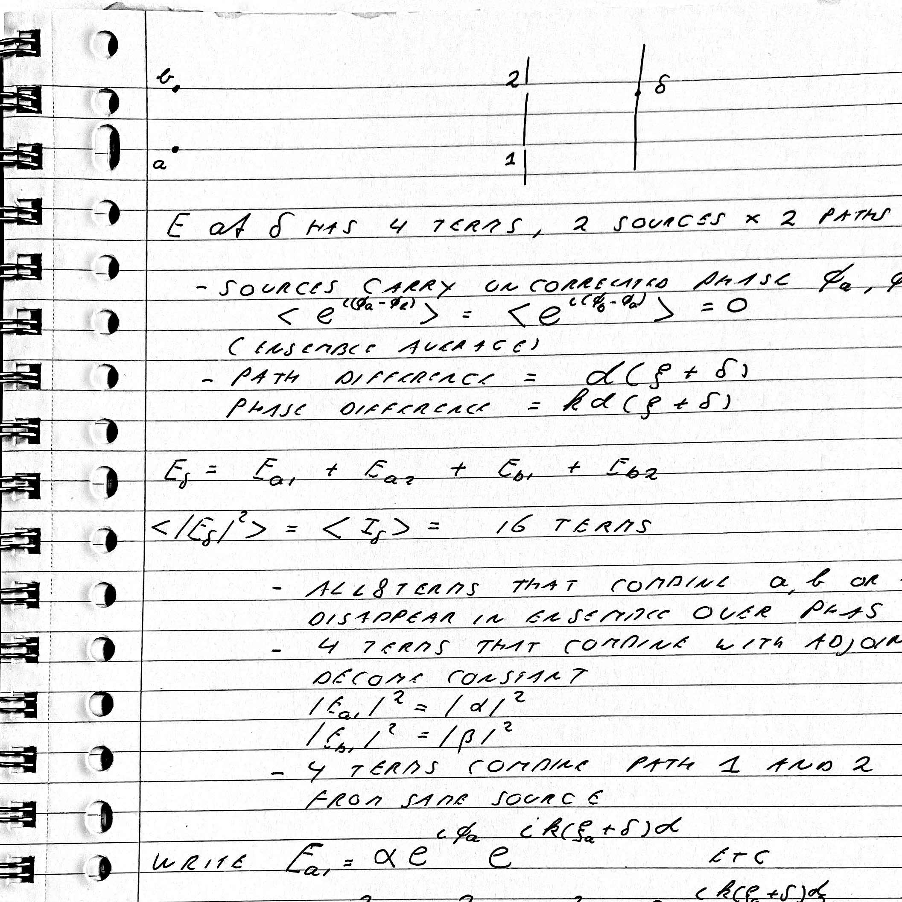

# Two Point Sources — Michelson Interference

Two sources, \(a\) and \(b\), and two paths, \(1\) and \(2\).

The electric field at the detector has **four terms**: two sources × two paths.

- Sources carry uncorrelated phases \(\phi_a\) and \(\phi_b\):

$$
\left\langle e^{i(\phi_a-\phi_b)}\right\rangle
=
\left\langle e^{i(\phi_b-\phi_a)}\right\rangle
=0
$$

(Ensemble average.)

- Path difference:

$$
\Delta L=d(\beta+\delta)
$$

- Phase difference:

$$
\Delta\phi=kd(\beta+\delta)
$$

The total field is

$$
E_j=E_{a1}+E_{a2}+E_{b1}+E_{b2}
$$

The average intensity is

$$
\left\langle |E_j|^2\right\rangle
=\langle I_j\rangle
$$

Expanding the product gives **16 terms**.

- Eight terms combining sources \(a\) and \(b\) disappear under ensemble averaging.

- Four terms corresponding to the individual intensities remain. The notes give:

$$
|E_{a1}|^2=|\alpha|^2
$$

$$
|E_{b1}|^2=|\beta|^2
$$

- Four terms combine paths 1 and 2 from the same source.

Writing the field components explicitly, the notes begin with an expression of the form

$$
E_{a1}=\alpha e^{i\phi_a}e^{ik(\beta+\delta)d}
$$

and similarly for the other components.

*The final expression is partly cut off in the photograph.*

