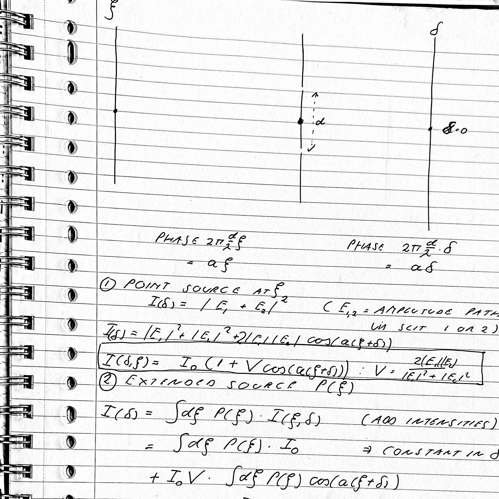

# Michelson fringes from an extended source: derivation

Worked from handwritten notes. Setup: a source with angular brightness profile $P(\xi)$, two slits a distance $d$ apart, and a distant screen with angular coordinate $\delta$ measured from the centre point between the slits. The wavelength is $\lambda$, and

$$
a=\frac{2\pi d}{\lambda}.
$$

Both the source side and the screen side carry a phase of $a$ times the angle, and the two phases add: $a(\xi+\delta)$.

## 1. Point source at angle $\xi$

With $E_{1,2}$ the amplitudes via slit 1 or slit 2,

$$
I(\delta;\xi)=\bigl|E_1+E_2\,e^{ia(\xi+\delta)}\bigr|^2
=|E_1|^2+|E_2|^2+2|E_1||E_2|\cos\bigl(a(\xi+\delta)\bigr).
$$

Define

$$
I_0=|E_1|^2+|E_2|^2,\qquad V_0=\frac{2|E_1||E_2|}{|E_1|^2+|E_2|^2}.
$$

Then

$$
\boxed{I(\delta;\xi)=I_0\Bigl[1+V_0\cos\bigl(a(\xi+\delta)\bigr)\Bigr]}
$$

$V_0$ is the slit-imbalance factor (equal to 1 for equal slits). It is renamed from $V$ in the notes, so that $V$ can denote the total fringe visibility below.

## 2. Extended incoherent source $P(\xi)$

Different points of the source have unrelated phases, so their **intensities** add:

$$
I(\delta)=\int d\xi\,P(\xi)\,I(\delta;\xi)
=I_0P_{\rm tot}+I_0V_0\int d\xi\,P(\xi)\cos\bigl(a\xi+a\delta\bigr),
\qquad P_{\rm tot}=\int P(\xi)\,d\xi .
$$

Expand the cosine,

$$
\cos(a\xi+a\delta)=\cos a\delta\,\cos a\xi-\sin a\delta\,\sin a\xi ,
$$

and define the cosine and sine transforms

$$
C=\int d\xi\,P(\xi)\cos a\xi,\qquad S=\int d\xi\,P(\xi)\sin a\xi .
$$

Then

$$
I(\delta)=I_0P_{\rm tot}+I_0V_0\bigl[C\cos a\delta-S\sin a\delta\bigr].
$$

## 3. Combine into a single cosine

Use $C\cos x-S\sin x=R\cos(x+\phi)$ with

$$
R=\sqrt{C^2+S^2},\qquad \cos\phi=\frac{C}{R},\quad \sin\phi=\frac{S}{R}
\quad\Bigl(\phi=\operatorname{atan2}(S,C)\Bigr).
$$

This gives

$$
I(\delta)=I_0P_{\rm tot}+I_0V_0\,R\,\cos(a\delta+\phi).
$$

Compactly, $C+iS=\tilde P(a)=\int P(\xi)\,e^{ia\xi}\,d\xi$, so $R=|\tilde P(a)|$ and $\phi=\arg\tilde P(a)$.

The fringe visibility (amplitude over mean) is

$$
\boxed{V=\frac{I_0V_0R}{I_0P_{\rm tot}}=V_0\,\frac{|\tilde P(a)|}{\tilde P(0)}}
$$

This is the normalized Fourier transform of the brightness distribution at spatial frequency $d/\lambda$, which is the van Cittert–Zernike result for an incoherent source.

One baseline $d$ gives one Fourier component: the contrast $V$ is its modulus and the fringe shift $\phi$ is its phase. To reconstruct $P(\xi)$ you need many baselines.

## 4. Worked example: top-hat source

Take

$$
P(\xi)=\begin{cases}1,&|\xi|<\Theta\\0,&\text{otherwise.}\end{cases}
$$

**Sine part.** $\sin a\xi$ is odd and the interval is symmetric, so $S=0$ and $\phi=0$ (or $\pi$ when $C<0$).

**Cosine part.** Substituting $\varphi=a\xi$ brings a factor $1/a$:

$$
C=\int_{-\Theta}^{\Theta}\cos a\xi\,d\xi
=\frac1a\int_{-a\Theta}^{a\Theta}\cos\varphi\,d\varphi
=\frac{2\sin a\Theta}{a}.
$$

With $P_{\rm tot}=2\Theta$,

$$
V=V_0\left|\frac{\sin a\Theta}{a\Theta}\right|.
$$

**First zero.**

$$
a\Theta=\pi
\;\Longrightarrow\;
\frac{2\pi d}{\lambda}\,\Theta=\pi
\;\Longrightarrow\;
\Theta=\frac{\lambda}{2d}.
$$

$\Theta$ is the half-width, so the full angular width is

$$
w=2\Theta=\frac{\lambda}{d}.
$$

A source of exactly this width shifts the fringe patterns of its points through one full period, and the sum is flat.

## Remarks

- For $a\Theta>\pi$ the coefficient $C$ is negative, so $\phi=\pi$: the fringes reverse contrast. $V=|C|/P_{\rm tot}$ stays non-negative.
- The sign in $(\xi+\delta)$ means a source above the axis moves the central fringe to $\delta=-\xi$. For symmetric $P$ this has no effect on $V$.
- The first zero depends on the source shape:
  - uniform strip of full width $w$: $d=\lambda/w$
  - equal double star with separation $\theta$: $V=|\cos(\pi\theta d/\lambda)|$, first zero at $d=\lambda/(2\theta)$
  - uniform disc of diameter $\alpha$: $d\approx1.22\,\lambda/\alpha$, from the zero of $2J_1(x)/x$ at $x\approx3.83$ (standard result, not checked against a source here)
  - Gaussian: no zero, only a gradual decline of $V$
- Intensity interferometry (Hanbury Brown–Twiss) measures $V^2$ and discards $\phi$. For a size that is enough.

## 5. Relation to $g^{(1)}$ and $g^{(2)}$

### Naming: order counts pairs of fields

The label $g^{(n)}$ counts **pairs** of fields, so $g^{(n)}$ contains $2n$ field factors:

| Name | Field moment | Number of fields | Measured by |
|---|---|---|---|
| $g^{(1)}$, first order | $\langle E^*E\rangle$ | 2 | Michelson, fringe visibility |
| $g^{(2)}$, second order | $\langle E^*E^*EE\rangle$ | 4 | Hanbury Brown–Twiss, intensity correlations |

So calling $\langle E^*E\rangle$ "second" and $\langle E^*E^*EE\rangle$ "fourth" is correct if you count fields. The $g^{(n)}$ convention counts pairs instead. Baym calls the notation "somewhat misleading, but traditional", and notes that $g^{(2)}$ is a fourth-order correlation function of the field. In Glauber's (1963) notation, $G^{(n)}$ has $n$ creation and $n$ annihilation operators.

### Definitions

With fields at the two slit positions $x_1,x_2$ (separation $d$), at equal times:

$$
g^{(1)}(d)=\frac{\langle E^*(x_1)\,E(x_2)\rangle}{\sqrt{\langle|E(x_1)|^2\rangle\,\langle|E(x_2)|^2\rangle}},
\qquad
g^{(2)}(d)=\frac{\langle I(x_1)\,I(x_2)\rangle}{\langle I(x_1)\rangle\,\langle I(x_2)\rangle}
=\frac{\langle E^*(x_1)E^*(x_2)E(x_2)E(x_1)\rangle}{\langle|E(x_1)|^2\rangle\langle|E(x_2)|^2\rangle}.
$$

### The fringe visibility is $|g^{(1)}|$

The mean intensity on the screen contains the cross term $2\,\mathrm{Re}\,\langle E_1^*E_2\rangle e^{ia\delta}$, so

$$
V=\frac{2\sqrt{I_1I_2}}{I_1+I_2}\,\bigl|g^{(1)}(d)\bigr|=V_0\,\bigl|g^{(1)}(d)\bigr|,
\qquad \phi=\arg g^{(1)}(d)
$$

(up to a sign convention for $\phi$). The slit-imbalance factor $V_0$ from Section 1 is the prefactor. With equal slits, $V=|g^{(1)}|$. Section 3 shows that, for an incoherent source, $g^{(1)}(d)=\tilde P(a)/\tilde P(0)$ (the van Cittert–Zernike result).

### The second-order function for chaotic light

For a chaotic source the field is a sum of many independent random contributions, so it is a (circular) Gaussian random variable. The four-field average then splits into products of two-field averages, pairing each $E^*$ with an $E$ in the two possible ways:

$$
\langle E_1^*E_2^*E_2E_1\rangle
=\langle E_1^*E_1\rangle\langle E_2^*E_2\rangle+\langle E_1^*E_2\rangle\langle E_2^*E_1\rangle .
$$

Dividing by $\langle I_1\rangle\langle I_2\rangle$ gives the Siegert relation:

$$
\boxed{g^{(2)}(d)=1+\bigl|g^{(1)}(d)\bigr|^2}
$$

With equal slits, $g^{(2)}(d)-1=V^2$.

### Example: the top-hat source

From Section 4, $V=\bigl|\sin(a\Theta)/(a\Theta)\bigr|$ for equal slits, so

$$
g^{(2)}(d)-1=\left[\frac{\sin(a\Theta)}{a\Theta}\right]^2,\qquad a=\frac{2\pi d}{\lambda}.
$$

- At $d=0$: $g^{(2)}=2$, the maximum bunching.
- The first null is at $a\Theta=\pi$, the same $d=\lambda/(2\Theta)$ as the Michelson fringes.
- It is never negative, because it is a square. The sign reversal of the fringes beyond the null, and the phase $\phi$, are lost.

### Caveats

- The Siegert relation requires chaotic (Gaussian) light. For an ideal laser, $g^{(1)}$ can have modulus 1 (perfect fringes) while $g^{(2)}=1$ at all separations, so good fringes do not imply an HBT excess.
- A toy model with only two random-phase point sources is not Gaussian. The $\cos(2\pi\theta d/\lambda)$ dependence is the same, but the constant offset differs (for equal sources $V^2=\tfrac12+\tfrac12\cos e$, whereas Baym's two-source correlation is $1+\tfrac12\cos e$). The relation $g^{(2)}-1=|g^{(1)}|^2$ holds for the many-source star.
- For steady classical light, $g^{(2)}(0)\ge1$ and $g^{(2)}(0)\ge g^{(2)}(\tau)$, so a dip below 1 at zero delay cannot be produced by a classical wave.

