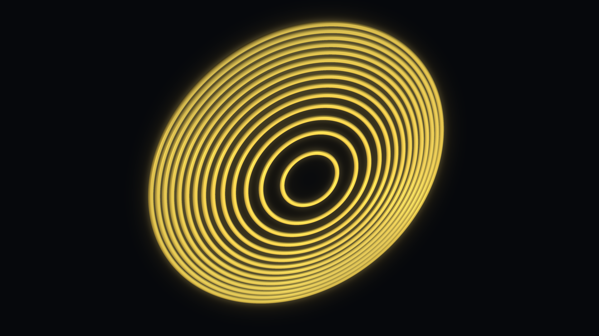
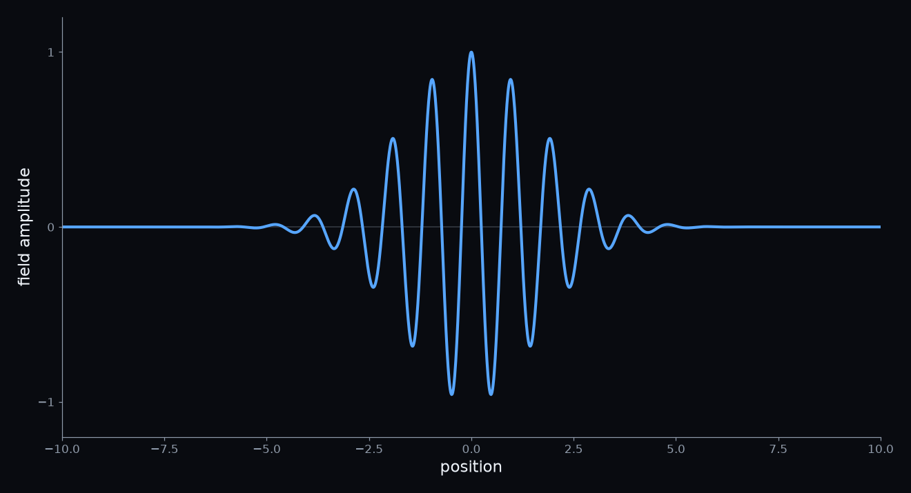
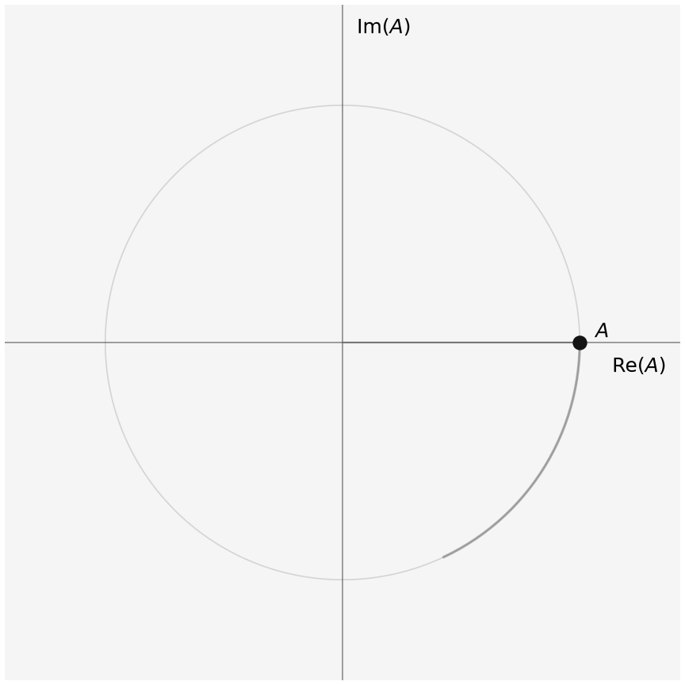
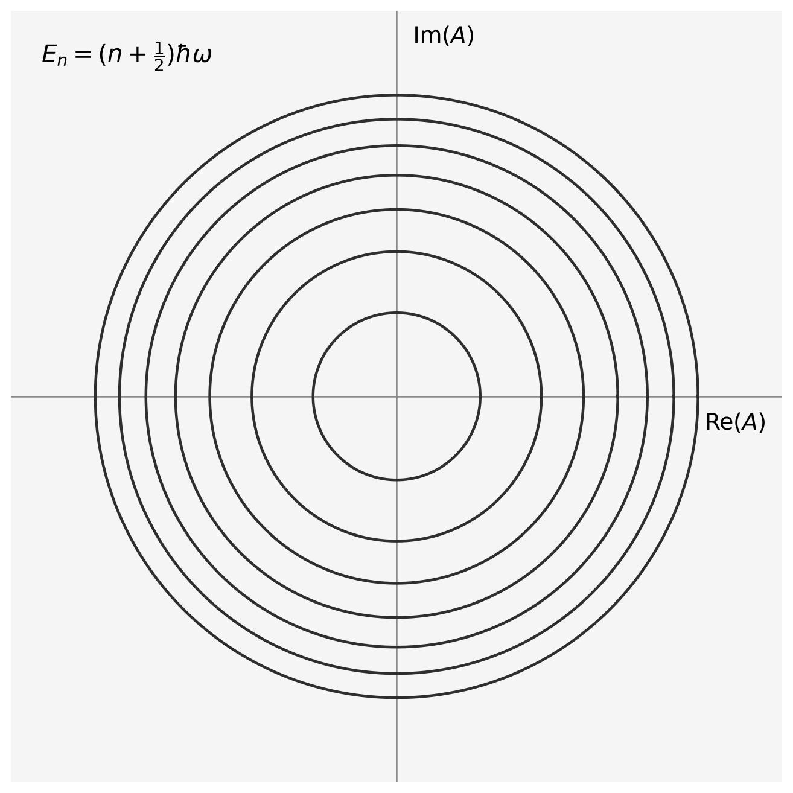
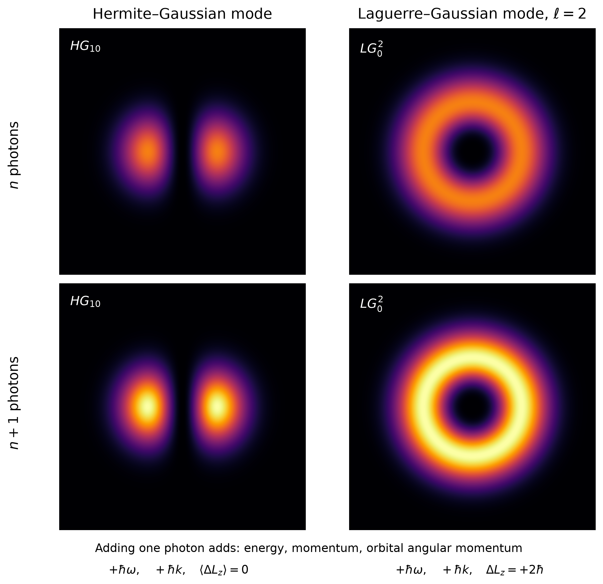

# What Is a Photon, Really?
### Classical light is already surprisingly particle-like. So what does quantization actually add?

> Caption: **The plane of a mode's complex amplitude. Classically, the mode can sit at any distance from the center. Quantum mechanically, only certain energies are allowed, and each ring marks one of them.**
> Alt text: A set of concentric white rings, drawn like thin glossy tubes and seen at an angle so they appear as tilted ellipses against a near-black background. The innermost rings are widely spaced; toward the outer edge the rings crowd closer and closer together.
> Source: Image by author.

## A Wave Packet Is Still Just a Classical Wave

A monochromatic wave stretches through all of space. But add several waves with slightly different wavelengths and something interesting happens. Near one place their peaks line up and reinforce each other; farther away they drift out of step and cancel. The result is a localized wave packet: a little bundle of waves travelling through space. It is tempting to look at that bundle and think: *there is the photon*. But everything in Figure 1 is ordinary classical wave physics. A radio pulse, a sound wave or even a water wave can be localized in the same way. Localization is a property of waves, not evidence of particles. No quantum mechanics is needed. A narrower packet simply requires a broader spread of wavelengths.

> **Localization does not make light into photons.**

> Caption: **Figure 1. A localized pulse is still a classical wave. Waves with slightly different wavelengths reinforce near the center of the packet and cancel farther away. Nothing here is quantum: localization comes from classical superposition.**
> Alt text: Animation on a dark background with axes labelled position and field amplitude. A blue oscillating wave packet, strongest at its center and fading to zero on either side, travels from left to right across the plot.
> Source: Image by author.

## Even Momentum Does Not Make It a Photon

Light is a propagating wave, and that wave carries energy and momentum. When light is absorbed or reflected, that momentum produces a tiny force known as radiation pressure. This does not require us to think of light as particles; these properties already belong to the classical description of the light wave.

And light can carry angular momentum too. The doughnut modes we saw in the previous post are an example. Their helical phase structure gives the field orbital angular momentum, which can make microscopic objects rotate.

If classical light can already be localized and carry momentum as well as angular momentum, then what, exactly, is the particle-like ingredient that quantization adds?

## One Mode, One Complex Number

Before we quantize light, let's strip it down to the simplest thing we can quantize: a single mode with fixed, linear polarization¹. A mode can have a simple shape or a complicated one. For example, the Gaussian beam from the previous post had a spatial shape of the form

$$
u(\mathbf{r},z)=\frac{1}{w(z)}
e^{-r^2/w(z)^2}
e^{ikr^2/2R(z)}
e^{-i\psi(z)}
e^{ikz}
$$

The precise shape is not important here. Other modes can have several lobes, a ring, or a twisting phase. The important point is that once we have chosen one particular mode, all of that spatial structure is fixed. We can collect it into a single function *u(**r**,z)*.

So choosing the mode fixes its shape, but not its strength or phase. We package those into one complex number *A(t)*. The real electric field can then be written schematically as

$$
E(\mathbf{r},z,t)
\propto
A(t)u(\mathbf{r},z)
+
A^*(t)u^*(\mathbf{r},z).
$$

All the spatial structure sits in *u(**r**,z)*; all the time dependence sits in *A(t)*. For a mode with a single frequency ω, *A(t)* simply rotates in the complex plane at that frequency.

We can picture *A* as a point in a plane, as shown in Figure 2. The distance from the center sets the strength of the field; the angle sets its phase. Let time run and the point circles the center, while its horizontal coordinate moves back and forth like the electric field itself.

To find the energy of the field, we integrate its energy density over space. The electric and magnetic fields contribute equally to the steady energy. We can absorb the magnetic contribution into our normalization and write, schematically,

$$
H\propto\int E^2\,dV.
$$

Put our expression for the field into this integral and four terms appear. Two oscillate at twice the optical frequency, but the magnetic field contributes matching terms that cancel them. What remains are two terms with the same spatial integral:

$$
H=\frac{\omega}{2}\left(A^*A+AA^*\right),
$$

where we have chosen the normalization of *A* so that the constant in front is ω/2.

Since *A* and *A*\* are ordinary complex numbers, their order makes no difference: *A*\**A* = *AA*\*. Classically, then, we could simply write

$$
H=\omega|A|^2.
$$

We are going to resist that simplification. The reason will become clear when we quantize the field. For now, we keep the two terms in their original order:

$$
H=\frac{\omega}{2}\left(A^*A+AA^*\right).
$$

In the classical picture, there is nothing special about any particular radius in Figure 2. *A* can sit anywhere in the plane, giving the field a definite amplitude and phase. Its energy can therefore take any value from zero upward. Put *A* at the origin and the field, and its energy, vanish.

That is the picture we are about to quantize.

> Caption: **Figure 2. One optical mode as a classical oscillator. The distance of *A* from the origin sets the field strength, while its angle sets the phase. As *A* circles the origin, its horizontal projection traces the oscillating electric field. Since the energy is proportional to |*A*|², every radius is allowed classically.**
> Alt text: Animation on a light background with horizontal axis Re(A) and vertical axis Im(A). A black dot labelled A moves around a faint circle centered on the origin, trailed by a short gray arc. A dark segment along the horizontal axis runs from the origin to the dot's horizontal position.
> Source: Image by author.

## Now Quantize the Field

To quantize a classical system, we start from its Hamiltonian — the expression for its energy — and replace its classical variables by operators. For our single mode, we deliberately kept the classical Hamiltonian in the form in which it arose from the field:

$$
H=\frac{\omega}{2}\left(A^*A+AA^*\right).
$$

Now comes the crucial step. We promote *A* and *A*\* from ordinary numbers to operators,  and †. Operators act on quantum states, and unlike ordinary numbers, their order can matter. Applying  first and † second need not give the same result as applying them in the opposite order. The difference between those two orders is written using a **commutator**:

$$
[\hat A,\hat A^\dagger]
=
\hat A\hat A^\dagger-\hat A^\dagger\hat A.
$$

For our electromagnetic mode, quantization means imposing

$$
[\hat A,\hat A^\dagger]=\hbar.
$$

> **This is where the quantization happens. We have replaced two classical quantities that commute with two quantum operators that do not. The difference made by changing their order is set by the fundamental quantum constant: Planck's constant ℏ (= *h*/2π).**

Readers familiar with quantum mechanics will recognise this from the harmonic oscillator, where position and momentum become non-commuting operators. The real and imaginary parts of *A* play the same roles here, which is why the same kind of commutator appears.

The quantum Hamiltonian now becomes

$$
\hat H=\frac{1}{2}\omega(\hat A^\dagger\hat A+\hat A\hat A^\dagger).
$$

From the commutator,

$$
\hat A\hat A^\dagger
=
\hat A^\dagger\hat A+\hbar,
$$

so we can rewrite the Hamiltonian as

$$
\hat H
=
\omega\hat A^\dagger\hat A
+
\frac{1}{2}\hbar\omega.
$$

Here the quantum picture departs from the classical one. Classically, we could take *A* all the way to zero and make the energy vanish. Now the commutator leaves behind an irreducible ½ℏω.

But we have not yet found the rest of the allowed energies. For that, we need to look more closely at what  and † actually do.

## Raising and Lowering the Energy

It is convenient to absorb ℏ into the definition of the operators:

$$
\hat a=\frac{\hat A}{\sqrt{\hbar}},
\qquad
\hat a^\dagger=\frac{\hat A^\dagger}{\sqrt{\hbar}}.
$$

Then

$$
[\hat a,\hat a^\dagger]=1
$$

and the Hamiltonian becomes

$$
\hat H=\hbar\omega\left(\hat a^\dagger\hat a+\frac{1}{2}\right).
$$

Now, what exactly is the meaning of these operators â and â†? We will see that they play a very intuitive role. The Hamiltonian contains the combination â†â. Think of its value as telling us how far up the energy scale the mode sits. Our commutator tells us that reversing the order adds exactly one:

$$
\hat a\hat a^\dagger
=
\hat a^\dagger\hat a+1.
$$

One can show from this relation that applying ↠raises the value of â†â by one, while applying â lowers it by one. Because each unit in the Hamiltonian is multiplied by ℏω, applying â lowers the energy by ℏω and applying ↠raises it by ℏω. That is why these operators are called the **lowering** and **raising** operators.

> **Applying the lowering and raising operators takes the energy in a mode through a ladder, with a distance ℏω between the steps.**

Applying â repeatedly takes us down the ladder one step at a time. Eventually we must stop, because â†â cannot have a negative value, so there is a lowest state. There, applying â gives zero, so â†â is zero. This is the **vacuum state** of the mode. But zero excitations does not mean zero energy. The Hamiltonian then gives

$$
E_0=\frac{1}{2}\hbar\omega.
$$

What is the meaning of the ½ℏω at the bottom of the ladder? Every mode has this lowest energy. Summed over all possible modes, these zero-point energies give an infinite result, which we normally subtract away. But that does not mean the vacuum is featureless. The field still fluctuates, and those vacuum fluctuations can show up as quantum noise in sensitive optical measurements and play a role in spontaneous emission.

Applying ↠repeatedly to the vacuum state generates energy levels

$$
E_n=\hbar\omega\left(n+\frac{1}{2}\right)
$$

where *n* counts the steps above the vacuum

$$
n=0,1,2,3,\ldots
$$

And now, finally, we can introduce the word **photon**. For an electromagnetic mode, one quantum of excitation — one step up this ladder — is what we call a photon. The operators â and ↠are therefore also called the **annihilation** and **creation** operators: they remove or add one photon to the mode.

> Caption: **Figure 3. Quantizing one mode. Before quantization, any point in the plane is allowed. Afterwards, the allowed energies form discrete rings corresponding to *Eₙ* = ℏω(*n* + ½) with *n* = 0, 1, 2, … . Even the innermost ring lies away from zero energy: zero photons, but nonzero energy. Note that the rings are not orbits: a state with a definite number of quanta has no definite phase.**
> Alt text: Seven concentric black rings centered on the origin of axes labelled Re(A) and Im(A), on a light background. The gaps between neighbouring rings shrink toward the outside. A short arrow labelled ↠points outward from one ring to the next, and a short arrow labelled â points inward. The label ΔE = ℏω appears in the top left corner.
> Source: Image by author.

## What One Quantum Carries

We can now return to where we started: light carries energy, momentum and angular momentum.

These were already properties of the classical electromagnetic mode. A travelling mode has a frequency ω and wave number *k*. Give it a twist and there is another number, ℓ, telling us how many times the phase winds around the axis.

Quantization does not create any of these properties. What changes is how much the mode can carry. Its momentum and angular momentum are proportional to the same â†â that appeared in the energy, so adding one excitation moves all three up by one step.

**energy increment: ℏω**

**momentum increment: ℏ*k***

**orbital angular momentum increment: ℓℏ**

For a travelling light mode, *k* = ω/*c*, so the energy step ℏω corresponds to the momentum step ℏ*k*.

Return to the Laguerre–Gaussian modes from the previous post. Their phase winds ℓ times around the axis, giving each excitation orbital angular momentum ℓℏ. With *n* photons, that becomes *n*ℓℏ, while the energy above the vacuum becomes *n*ℏω. So both *n* and ℓ are integers — but not for the same reason.

The parameter ℓ is already discrete classically: after circling the axis, the phase must return to itself, allowing only a whole number of 2π windings. The integer *n* appears only when we quantize the field and find the energy ladder of Figure 3.

A photon does not acquire its momentum or angular momentum because it is a tiny particle flying along a particular trajectory. Those quantities are already encoded in the mode. A photon is one quantum of excitation of that mode, and therefore carries one quantum's share of its energy, momentum and angular momentum.

The twist belongs to the wave. The quantization tells us how much comes with each excitation.

> Caption: **Figure 4. What one quantum carries. Each step up the ladder adds one excitation to the same electromagnetic mode. With it come ℏω of energy, ℏ*k* of momentum and orbital angular momentum: 2ℏ for the vortex mode, zero on average for the Hermite–Gaussian mode. The mode itself keeps the same spatial shape. The indices on HG₁₀ and LG₀² label the shape of the mode, not the number of photons. The brightness difference between the rows is exaggerated for illustration.** 
> Alt text: A two-by-two grid of intensity patterns on black backgrounds. The left column, headed Hermite–Gaussian mode and labelled HG₁₀, shows two side-by-side bright lobes. The right column, headed Laguerre–Gaussian mode, ℓ = 2, and labelled LG₀², shows a bright ring with a dark center. The top row is labelled n photons and the bottom row n + 1 photons; the bottom patterns have the same shapes but are brighter. Below the grid, a line reads "Adding one photon adds: energy, momentum, orbital angular momentum", followed by the labels +ℏω, +ℏk, ⟨ΔL_z⟩ = 0 under the left column and +ℏω, +ℏk, ΔL_z = +2ℏ under the right.
> Source: Image by author.

## A Photon Is Not the Wave Packet

So, adding a photon to a mode means we increase the energy, momentum and angular momentum of that mode by specific amounts, much as if we had added one particle to a stream of particles. Does that mean we now know where the photon is? The question mixes two ideas: **localizing the field and quantizing it.**

A mode can be spread across the laboratory or localized in a wave packet. That is possible classically. Quantization adds something new: it tells us how many excitations occupy that mode.

The two are independent. A localized wave packet can contain any number of photons. Conversely, a one-photon state can be localized or spread out, depending on the mode it occupies.

> **Localization belongs to the mode; photon number belongs to its excitation.**

This gives us a better picture of a photon. It is not the wave packet, nor a little particle hidden inside it. It is one quantum of excitation of the mode.

Quantization changes the question we ask about a mode. It is no longer how much energy the mode contains, but how many excitations. That is the particle-like ingredient classical light was missing.

## A Click Does Not Prove a Photon

But what about the clicks from a photodetector? Do those show individual photons arriving? Not quite. 

Treat the light as a classical wave and only the detector quantum mechanically, and the clicks still appear [1]. They come at random times, at a rate set by the intensity of the light. The discreteness can come from the detector rather than from the light. Even the photoelectric effect, the historical argument for photons, can be explained this way. So, the clicks themselves, and the rate at which they arrive, do not require a quantum theory of light.

Quantum mechanics allows many different states of light. Some, like the light from a laser, produce clicks just as a classical wave would. Others do not. A mode holding exactly one photon sits on one of the rings of Figure 3, with no definite phase. Split that light between two detectors, and only one of them ever clicks, never both [2]. No classical wave, however weak, can do that. Two detectors mean two modes, and the question of how their excitations are related. That is where the next post begins.

¹The article considers linearly polarized light. If we include the option of circular polarization we would need to include an additional ('spin') angular momentum of +ℏ or −ℏ per photon.

## References

1. W. E. Lamb Jr. and M. O. Scully, "The photoelectric effect without photons," in *Polarisation, Matière et Rayonnement* (Presses Universitaires de France, 1969).

2. P. Grangier, G. Roger and A. Aspect, "Experimental evidence for a photon anticorrelation effect on a beam splitter: a new light on single-photon interferences," Europhysics Letters 1, 173 (1986).

<!-- 
METADATA 
date: 2026-09-30
revision: 1 
 
medium: 
  topics: 
    - Quantum Physics
    - Physics
    - Quantum Mechanics
    - Optics
    - Science
  seo_title: What Is a Photon, Really?
  seo_description: Light can form wave packets and carry momentum without photons. So what does quantization actually add? Starting from one electromagnetic mode, we build the photon from the quantum energy ladder.
  preview_title: What Is a Photon, Really?
  preview_subtitle: Classical light is already surprisingly particle-like. So what does quantization actually add?
  publication: Science Spectrum
  canonical_url: "None"
-->