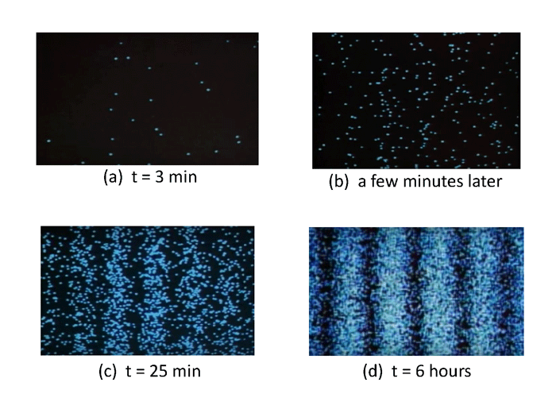
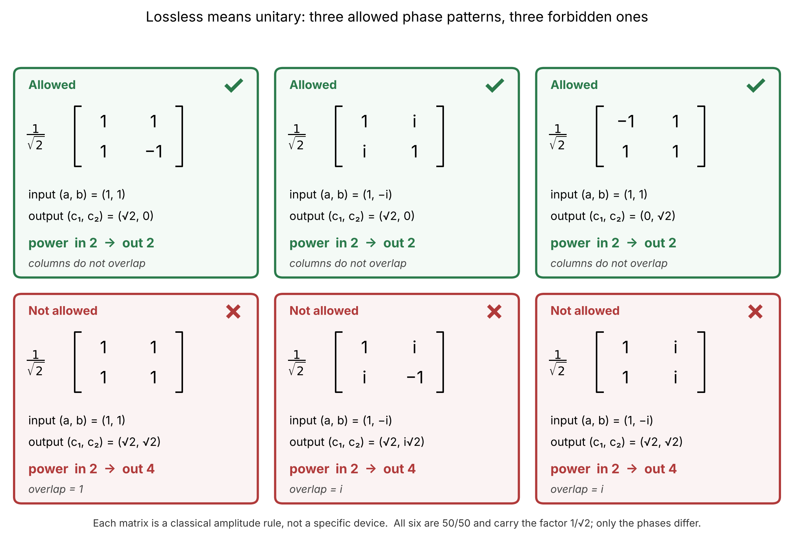

# How Do We Know Light Is Really Quantum?

*A detector click isn't enough. The real evidence appears when we compare what detectors see.*

In the previous post, we saw how quantizing the electromagnetic field leads naturally to photons: discrete excitations of its modes, each carrying energy ℏω. But how do we know that light really behaves this way? After all, a detector responding to light produces individual clicks, even when the incoming light is described as a classical electromagnetic wave. A semiclassical model, combining classical light with a quantum detector, can already explain these discrete detection events. A click alone is therefore not enough to establish that the light itself is quantum.

The difference emerges when we start comparing detection events. Instead of looking at individual clicks, we can study correlations between detections in different optical modes, or between detections at different times. Some of these correlations can still be explained by classical electromagnetic waves. Others cannot. They reveal behaviour that requires a quantum description of light itself. **And that gives us a way to answer our original question: how do we know that light is really quantum?**

## A Click Is Not Proof of a Photon

Almost everyone has seen the famous double-slit experiment. Light passes through two narrow openings and reaches a screen, where individual dots appear, seemingly at random. As more dots accumulate, a familiar interference pattern slowly emerges. This is often presented as one of the clearest demonstrations of the wave-particle duality of light: each photon arrives as a particle, yet somehow interferes like a wave.

But does this experiment really demonstrate that light consists of photons?

Consider what happens if we describe the incoming light as an ordinary classical electromagnetic wave. The wave passes through both slits, and the two contributions interfere at the screen. If their electric fields are E₁ and E₂, the resulting intensity is proportional to

$$
I(x) \propto |E_1(x)+E_2(x)|^2.
$$

Nothing quantum is needed for this interference pattern. It follows directly from Maxwell's equations.

Now consider the screen itself. Its atoms and electrons are quantum systems, and they can absorb energy through discrete transitions. Even when illuminated by a continuous classical field, an ideal photodetector can produce individual, randomly timed clicks. The probability of a click in a short time interval depends on the local light intensity.

Put these two things together. The classical field determines where the intensity is high or low, while the quantum detector produces individual detection events with probabilities proportional to that intensity. At first, the dots appear randomly scattered. As their number increases, they gradually reveal the familiar interference pattern.

*Figure 1. An interference pattern, one click at a time.* Frames from a photon-counting camera video by Hamamatsu [3]. Individual detection events appear at random positions, and the pattern emerges as events accumulate. The frames show where events landed, not whether the events are correlated with each other. Photon-counting cameras locate each detected event individually [5]. A detector that responds in discrete events is what any quantum detector does, even in a semiclassical model, so this buildup does not by itself show that the electromagnetic field is quantized. For background on how light is described, see [4]. *(Reproduced with permission from Hamamatsu Photonics. Permission requested, to be confirmed.)*

**We have reproduced the point-by-point buildup of the double-slit interference pattern without quantizing the electromagnetic field.**

This is not a new interpretation invented for our argument. Semiclassical photodetection theory, a classical wave with a quantum detector, was developed by Mandel, Sudarshan and Wolf [1], and a semiclassical simulation of the double-slit buildup has been published [2].

Of course, this does not mean that light is not quantum. Nor does it mean that every experiment involving individual photons can be explained semiclassically. It means something more specific: the interference pattern and its gradual appearance through individual detection events do not, by themselves, establish that the electromagnetic field is quantized.

So what additional measurement would allow us to distinguish classical light from genuinely quantum light?

## A Beam Splitter That Creates Energy

The answer starts with one of the simplest devices in optics: a beam splitter followed by two detectors. Before asking what it does to quantum light, we need to know what it does to classical light, because the quantum description will turn out to be the same transformation.

Describe the light entering each input port by a single complex amplitude, $a$ and $b$. The amplitudes leaving the two output ports, $c_1$ and $c_2$, are combinations of the two inputs:

$$
\begin{pmatrix} c_1 \\ c_2 \end{pmatrix} = U \begin{pmatrix} a \\ b \end{pmatrix}.
$$

The splitter is lossless: nothing is absorbed, so the total output power must equal the total input power, $|c_1|^2+|c_2|^2 = |a|^2+|b|^2$.

We want a 50/50 splitter, so the simplest guess is

$$
U = \frac{1}{\sqrt{2}}\begin{pmatrix} 1 & 1 \\ 1 & 1 \end{pmatrix}.
$$

Send light into one port only, say $a=1$, $b=0$. Each output receives amplitude $1/\sqrt{2}$, hence power $1/2$. Total power out is 1, equal to the power in. The same holds for light entering the other port. The matrix passes every test we have tried.

Now illuminate both inputs with equal amplitudes, $a=b=1$. The input power is 2. Each output amplitude is $2/\sqrt{2}=\sqrt{2}$, so each output carries power 2, and the total is 4. **Our beam splitter has just doubled the energy.**

What went wrong? Testing one input at a time never lets the two beams interfere. With both inputs lit, the amplitudes add before we square them, and the output power picks up a cross term that depends on their relative phase:

$$
|c_1|^2+|c_2|^2 = |a|^2+|b|^2 + 2\,\mathrm{Re}\!\left[a^*b\,\big(U_{11}^*U_{12}+U_{21}^*U_{22}\big)\right].
$$

The bracket is built from the two columns of $U$. For power to be conserved for every pair of amplitudes and every relative phase, it has to vanish: the two columns must be orthogonal. Each column must also carry unit total power, which our single-input tests already checked. Together these conditions say $U^\dagger U=I$ (the matrix times its conjugate transpose is the identity), and a matrix that satisfies them is called **unitary**. Lossless means unitary. For our matrix the bracket equals $\tfrac12+\tfrac12=1$, the largest it could be, so the cross term does all the damage.

The repair is to flip one sign:

$$
U = \frac{1}{\sqrt{2}}\begin{pmatrix} 1 & 1 \\ 1 & -1 \end{pmatrix}.
$$

Now the bracket is $\tfrac12-\tfrac12=0$. One input still splits 50/50, but equal inputs now interfere so that all the light leaves through output 1 and none through output 2. **Interference redirects energy; it does not create it.**

*Figure 2. Lossless means unitary.* Each matrix is a classical amplitude rule, not a specific device. Top row: three allowed splitters, all 50/50, that differ only in their phases. Bottom row: three forbidden ones. Light entering a single port splits correctly in all three, but with both ports lit at the right relative phase the output power is 4 instead of 2. For the two matrices with $i$ entries, the failing input is $(1,-i)$, not equal amplitudes.

Nothing here is specific to beam splitters. A wave plate mixing two polarization components, or the Hermite–Gauss to Laguerre–Gauss converter from Post 1, is described by the same kind of 2×2 unitary matrix. The devices differ; the mathematics does not.

## Moving Photons Between Modes

*(Working heading. Draft for review.)*

That settles what a beam splitter does to a classical wave. What does it do to photons?

In the previous post we met the operators $\hat a$ and $\hat a^\dagger$, which lower and raise the energy of a mode by one step: they remove or add a photon. A beam splitter connects two modes, $a$ and $b$, so there are two ladders and two new moves.

$\hat b^\dagger\hat a$ removes an excitation from mode $a$ and adds one to mode $b$. $\hat a^\dagger\hat b$ does the reverse.

How strongly a move acts depends on how many photons are present. Acting on $|n_a,n_b\rangle$, the move $\hat b^\dagger\hat a$ gives $\sqrt{n_a(n_b+1)}\,|n_a-1,\,n_b+1\rangle$. There is more to take from when $a$ is full, and moving into a mode that already holds photons is favoured: for $|1,1\rangle$ the move into the occupied mode has amplitude $\sqrt2$, twice the probability of moving a lone photon into an empty mode. This is the first hint of the bunching tendency of photons, which the beam splitter will make complete.

Together, these two moves describe what a beam splitter does: it passes excitations back and forth between the two modes, and never creates or destroys one. The total number of photons stays the same. A beam splitter applies the exchange only partially, with the amount set by its reflectivity. A single photon entering port $a$ ends up as a superposition of "still in $a$" and "moved to $b$", $\cos\theta\,|1,0\rangle-i\sin\theta\,|0,1\rangle$. For a 50/50 splitter, $\theta=\pi/4$, the two weights are equal, and the photon is found in either output with probability ½. (The factor $-i$ is a matter of convention. Adding phase shifts at the ports turns this into the real matrix of Figure 2 and changes nothing for the photon-number states used here.)

Now put one photon in each input, $|1,1\rangle$. Either move takes a photon from one mode to the other and leaves both photons in the same mode: $|2,0\rangle$ or $|0,2\rangle$. Can the photons also leave one in each output? There are two ways. The photon from input $a$ reaches output 1 and the photon from $b$ reaches output 2, or $a$ reaches output 2 and $b$ reaches output 1. If the photons are identical, we cannot tell these two ways apart, and quantum mechanics tells us to add their amplitudes, not their probabilities. With the splitter matrix of Figure 2, the first way has amplitude $U_{11}U_{22}=-\tfrac12$ and the second $U_{12}U_{21}=+\tfrac12$:

$$
U_{11}U_{22}+U_{12}U_{21}=-\tfrac12+\tfrac12=0 .
$$

The two ways cancel exactly. This is the minus sign that rescued energy conservation in Figure 2, now doing a second job. It is not an accident of our choice of sign: for any balanced splitter, unitarity forces the two amplitudes to cancel.

What is left is the state $(|2,0\rangle-|0,2\rangle)/\sqrt2$. Both photons leave through the same output, each output with probability ½. The photons bunch.

*[Figure 3 — to be drawn. Two identical photons enter a balanced splitter. The two ways to reach "one photon in each output" are shown with amplitudes −½ and +½, cancelling. The surviving outcomes are both photons in output 1 or both in output 2.]*

## Equally Likely to Click, but Never Together

*(Working heading. Draft for review.)*

What does this look like in a measurement? Place a detector at each output and send in two identical photons, one per input. A detector that cannot count photons only registers a click, so we never know whether it saw one photon or two. Each detector clicks in half of the trials, whenever both photons arrive at its output, and the two detectors never click together.

Two independent particles, each free to choose an output, would give a joint click in half of the trials. Two classical waves of equal intensity can interfere, and for one particular phase between them all the light leaves through one output, so there are no joint clicks. But that needs a fixed phase relation between the two beams. If the beams have no phase relation, as for independent sources, a classical wave can reduce the coincidences to at most half the rate we find when the beams are made distinguishable [9]. Photons cancel them completely. A classical dip as deep as ours needs a phase reference between the beams, which independent photons do not have.

To see that the photons really have to be identical, delay one of them until the two can be told apart. The two ways no longer cancel, and the coincidences return. This is the experiment of Hong, Ou and Mandel [6]. The dip they measured is the signature, as long as no phase reference links the two inputs: a dip deeper than 50% from independent sources cannot come from a classical wave. What the effect shows is how two-photon amplitudes interfere: indistinguishability decides whether they cancel. It is a striking mechanism, but since a classical field with a phase reference can imitate a deep dip, it is not the cleanest test.

So far we have compared the two detectors at the same instant. For a cleaner test, we compare their clicks at different times.

## When Do the Clicks Arrive?

*(Working heading. Draft for review.)*

Photon-number-resolving detectors exist. In principle they let us send in a series of wave packets and see the difference directly: a classical wave gives noisy counts, a number state the same count every time. In practice every lost photon blurs that difference, and an exact count needs near-perfect efficiency.

A coincidence measurement is more forgiving, because the normalized coincidence rate does not change if some photons are lost. So we look at correlations. Split the light with a beam splitter, put a detector at each output, and record how often both click, as a function of the delay $\tau$ between the two clicks. This is the Hanbury Brown–Twiss arrangement. We use two detectors because a single detector has a dead time after each click, during which it cannot register a second photon. It would miss exactly the closely spaced pairs we are looking for.

For a steady classical wave, each detector clicks at a rate set by the intensity, independently of the other. The coincidence rate is the same at every delay: the detectors can click together or a while apart. If the intensity fluctuates, clicks tend to cluster and the coincidences peak at zero delay. Either way, a classical wave never makes a simultaneous click less likely than a click a long time apart.

Why can't a classical wave do this? A click at time $t$ has a probability proportional to the intensity $I(t)$. So the probability of a click at $t$ and another at $t+\tau$ is proportional to $I(t)\,I(t+\tau)$, averaged over the fluctuations. For any two real numbers, $\big(I(t)-I(t+\tau)\big)^2\ge0$, which means $I(t)\,I(t+\tau)\le\tfrac12\big[I(t)^2+I(t+\tau)^2\big]$. For steady light both squares average to the same value, so the coincidences at delay $\tau$ can never exceed those at zero delay. The same trick with $I-\langle I\rangle$ shows that the coincidences at zero delay are never below those at long delays, where the clicks are independent. In the usual notation this is the bound $g^{(2)}(0)\ge g^{(2)}(\tau)$, where $g^{(2)}(\tau)$ is the coincidence rate at delay $\tau$ divided by the rate for independent clicks. It holds for any steady classical wave, however it fluctuates.

Light from a single atom does something no classical wave can. Just after emitting a photon, the atom cannot emit another until it is excited again. Coincidences at zero delay are therefore rarer than at longer delays, and the coincidence rate rises with $\tau$. This was observed in 1977 in the fluorescence of sodium atoms [7] (Figure 4). The signature is the rise itself: any coincidence rate at zero delay that lies below the long-delay rate is forbidden classically, however shallow the dip. In this experiment the rise is clear but does not start from zero, because more than one atom was usually in the beam. Measurements on a single quantum dot, where only one emitter contributes, show the dip going almost to zero [8].

*[Figure 4 — Kimble, Dagenais and Mandel [7], Fig. 2: pair counts against delay in 2 ns steps, rising from zero delay. Caption to add: the depth of the dip depends on how many emitters contribute; the rise is the opposite of the peak made by a fluctuating classical wave. Reproduced with permission from the American Physical Society. Permission requested, to be confirmed. Fallback: an author-drawn version, or Fig. 4(b) of [8], which is open access.]*

**A steady classical wave can make clicks bunch together in time. It can never make them avoid each other.**

## What the Clicks Cannot Show

*(Working heading. Draft for review.)*

We started by asking whether a quantum detector illuminated by a classical wave can explain what we see. For single clicks and for interference patterns, it can. For correlations, the answer depends on which correlation.

A classical wave can produce anticorrelations between two modes. At the beam splitter, for the right phase between the inputs, all the light leaves through one port and the two detectors never click together. Intensity-driven clicks reproduce that. The Hong–Ou–Mandel effect goes further: without a phase reference between the inputs, a classical wave cannot cut the coincidences below half, while photons cancel them completely. It shows how indistinguishable two-photon amplitudes interfere, and it is the surprising quantum mechanism of this post. But the test is subtle, because a classical field with a phase reference can imitate a deep dip.

The decisive test is in time. For steady light, no classical wave can have fewer coincidences at zero delay than at long delay: $g^{(2)}(0)\ge g^{(2)}(\tau)$. The fluorescence of sodium atoms violates this bound [7]. A single emitter cannot emit a second photon right after the first, and no fluctuating wave imitates that.

This brings us back to the double slit. The frames of Figure 1 show clicks building up an interference pattern, and a quantum detector illuminated by a classical wave produces the same pictures. They say nothing about correlations between events, and the Hamamatsu images do not demonstrate antibunching. A test is easy to propose, though. Count the events on the whole screen in very short frames. For any classical wave, the number of frames with two events can never fall below what independent clicks at the same average rate would give. A source that emits one photon at a time would give almost none. *(Proposed test, not an experiment cited here. Add a reference if one exists, or keep it as a thought experiment.)*

So how do we know light is really quantum? Not from a click, and not from an interference pattern that builds up one click at a time. We know it from correlations in the clicks themselves: clicks that avoid each other in time, where no classical wave can follow.

*(Section and closing are first drafts.)*

## Looking Ahead

*(Working heading. Draft for review.)*

In the next post we meet the states of light on either side of this line: the number states used here, the coherent states of a laser, thermal light and squeezed states, and ask what each looks like to a detector.

### References

[1] Mandel, L., Sudarshan, E. C. G., and Wolf, E. (1964). *Theory of Photoelectric Detection of Light Fluctuations.* Proceedings of the Physical Society **84**, 435–444. https://doi.org/10.1088/0370-1328/84/3/313

[2] Rashkovskiy, S. A. (2015). *Semiclassical Simulation of the Double-Slit Experiments with Single Photons.* Progress of Theoretical and Experimental Physics **2015**, 123A03. https://doi.org/10.1093/ptep/ptv162

[3] Hamamatsu Photonics, photon-counting video (title to be confirmed). https://youtu.be/I9Ab8BLW3kA

[4] *The Nature of Light.* Ocean Optics Web Book. https://www.oceanopticsbook.info/view/light-and-radiometry/the-nature-of-light

[5] Tsuchiya, Y., Inuzuka, E., Kurono, T., and Hosoda, M. (1986). *Photon-Counting Imaging and Its Application.* In B. L. Morgan (Ed.), Advances in Electronics and Electron Physics, vol. 64A, pp. 21–31. Academic Press. https://doi.org/10.1016/S0065-2539(08)61600-5

[6] Hong, C. K., Ou, Z. Y., and Mandel, L. (1987). *Measurement of subpicosecond time intervals between two photons by interference.* Physical Review Letters **59**, 2044–2046. https://doi.org/10.1103/PhysRevLett.59.2044 *(citation to be verified)*

[7] Kimble, H. J., Dagenais, M., and Mandel, L. (1977). *Photon Antibunching in Resonance Fluorescence.* Physical Review Letters **39**, 691–695. https://doi.org/10.1103/PhysRevLett.39.691

[8] Mikushev, S., and Kalinichev, A. (2025). *Methodological Approach to the Characterization of Single-Photon Sources Using a Hanbury Brown–Twiss Interferometer in a Laser-Excited Fluorescence Microscope.* Quantum Beam Science **9**(4), 30. https://doi.org/10.3390/qubs9040030

[9] Fabre, N., Amanti, M., Baboux, F., Keller, A., Ducci, S., and Milman, P. (2022). *The Hong–Ou–Mandel experiment: from photon indistinguishability to continuous-variable quantum computing.* European Physical Journal D **76**, 196. https://doi.org/10.1140/epjd/s10053-022-00525-0 (open access, CC BY 4.0; Sect. 2.1 and Eqs. 3, 4, 12)

---

### Editorial Continuity Notes (Not Article Prose)

#### Status (13 October 2026)

- Intro and "A Click Is Not Proof of a Photon" are the agreed baseline (Figure 1 and sources [3]–[5] added).
- "A Beam Splitter That Creates Energy" is agreed for now.
- "Moving Photons Between Modes", "Equally Likely to Click, but Never Together" and "When Do the Clicks Arrive?" are first drafts. Headings are working titles.

#### The story spine

1. Semiclassical theory (classical wave, quantum detector) explains single clicks and even patterns.
2. So we look at correlations, first between modes. Coupling two modes classically needs a unitary matrix, which for a balanced splitter means a relative minus sign or an equivalent phase.
3. Quantum mechanically, the swap operators $\hat b^\dagger\hat a$ and $\hat a^\dagger\hat b$ move excitations between the modes; the splitter applies the exchange partially.
4. One photon in each input: two indistinguishable ways to reach one photon per output, with amplitudes $-\tfrac12$ and $+\tfrac12$. They cancel, so the photons bunch.
5. Both detectors click equally often (each in half the trials) but never together. A semiclassical theory does not explain this.
6. Then correlations in time: a Hanbury Brown–Twiss measurement. A classical wave gives a flat or peaked coincidence histogram, never a rise from zero delay; quantum light from a single emitter does (Kimble et al.).
7. Why the semiclassical model misses both: each detector clicks with an intensity-set probability, independent given the field. Back to the double slit: the buildup alone proves nothing, the statistics of the dots could.

#### Reviewer feedback integrated on 13 October (version g)

1. *Closing section:* accepted. The earlier claim that independent clicks cannot produce correlations weaker than independent clicks was wrong for cross-mode correlations (a classical phase-locked beam splitter anticorrelates the outputs). Now: cross-mode anticorrelation can be classical; the decisive bound is $g^{(2)}(0)\ge g^{(2)}(\tau)$ for steady light. The double-slit return is a proposed test using total event counts per short frame (classically $\langle n(n-1)\rangle\ge\langle n\rangle^2$, i.e. Mandel $Q\ge0$, loss-independent), explicitly not demonstrated by the Hamamatsu images.
2. *Unitarity:* accepted. Wrong matrix, paradox and cross-term equation kept; surrounding text shortened; $U^\dagger U=I$ added with a plain-words gloss.
3. *Operators:* accepted. Matrix element $\sqrt{n_a(n_b+1)}$ added with the $|1,1\rangle$ example ($\sqrt2$ amplitude, twice the probability). No Hamiltonian derivation.
4. *Detectors:* accepted. Photon-number-resolving detectors exist; loss and efficiency are the limit. The HBT motivation is now: the normalized coincidence rate is loss-insensitive, and a single detector's dead time would miss close pairs.
5. *Literature:* MSW is named as the foundation. Rashkovskiy [2] could only be checked partly (the publisher page shows a truncated abstract), so the text now says only that "a semiclassical simulation of the double-slit buildup has been published"; see open items. [6] matches the entry in the reference list of [9]. Permissions from Hamamatsu and APS are still to be obtained by the author. The Figure 1 caption now says the frames do not show correlations.
6. *Looking ahead:* accepted. Reduced to one paragraph, placed last.
7. *Hierarchy:* accepted. HOM is presented as the surprising mechanism and antibunching as the decisive answer to the title.

#### Decisions made on 13 October

- **Order:** classical unitarity first, then the quantum operators.
- **No time, no Hamiltonian:** the mixing is described by an angle $\theta$. The exchange operator is introduced through the two moves, in Post 2's ladder language. The formal exponential $e^{-i\theta(\hat a^\dagger\hat b+\hat b^\dagger\hat a)}$ is left out for now.
- **The exchange is applied partially:** the full move is not unitary on two photons ($B|1,1\rangle=\sqrt2(|2,0\rangle+|0,2\rangle)$ has norm 2).
- **Phase convention (option 2):** Figure 2's real matrix is kept for the repair and for the two-ways argument. The swap passage uses $\cos\theta\,|1,0\rangle-i\sin\theta\,|0,1\rangle$, and one parenthetical sentence bridges the conventions ($U_{\text{real}}=\mathrm{diag}(1,i)\,U_H\,\mathrm{diag}(1,i)$).
- **Cancellation by unitarity:** for a general 2×2 unitary $U=e^{i\alpha}\begin{pmatrix}p&q\\-q^*&p^*\end{pmatrix}$, $U_{11}U_{22}+U_{12}U_{21}=e^{2i\alpha}(|p|^2-|q|^2)$, which vanishes for a balanced splitter and gives $T-R$ in general.
- **Click statement:** for $(|2,0\rangle-|0,2\rangle)/\sqrt2$ each non-resolving detector clicks in half of the trials and never both. For distinguishable photons the joint click probability is ½ per trial.
- **Semiclassical claim for HOM, sharpened again (13 October, after Fabre et al. [9]):** the 50% bound holds for inputs with no phase relation (uniformly random phase). A classical field with phase restricted to $\{0,\pi\}$ gives 100% visibility (Sadana et al. 2019, ref. [13] of Fabre et al., not read), because the dip is then carried by the first-order, phase-dependent term; over many trials the two detectors click equally often, but in each trial the light goes to one port. The earlier wording "classical waves cannot share equally and never click together" was too strong. Behind it: for equal intensities $I$ and relative phase $\varphi$, $I_1I_2=I^2\sin^2\varphi$. Fabre et al. derive the bound for coherent states with equal intensity; a general-field source (Paul 1986, Mandel) is still wanted.
- **Temporal section:** HBT with a beam splitter and two detectors. The classical limit is derived in the main text through $(I(t)-I(t+\tau))^2\ge0$ and $(I-\langle I\rangle)^2$ averages, stated in words with no $g^{(2)}$ notation. The bridge sentence connecting the dip to sub-shot-noise counting was dropped.
- **Added by the assistant, to be confirmed:** the parenthetical "we use two detectors so that the dead time of one detector cannot hide a coincidence in the other"; the sentence on quantum-dot measurements, citing [8].

#### Parked for now

- **Sub-Poissonian counting statistics and number-state noise.** The key relations are in the working notes: Mandel's formula $\mathrm{Var}\,n=\langle n\rangle+\mathrm{Var}\,W\ge\langle n\rangle$; for $n$ photons detected with efficiency $\eta$, the Fano factor is $1-\eta$ and $g^{(2)}(0)=1-1/n$ regardless of loss.
- **Candidate references (checked against their records on 13 October):** Short and Mandel, Phys. Rev. Lett. **51**, 384 (1983), sub-Poissonian counts in resonance fluorescence; Varcoe, Brattke, Weidinger and Walther, Nature **403**, 743 (2000), pure Fock states with up to two photons in a micromaser; Machida, Yamamoto and Itaya, Phys. Rev. Lett. **58**, 1000 (1987), amplitude-squeezed semiconductor laser (7.3% below shot noise, 31% corrected); PRL **59**, 2555 (1987), twin beams with intensity-difference noise about 30% below shot noise (authors believed to be Heidmann et al., to verify).
- **Phase-sensitive hand-off to Post 4:** Schulte, Hansom, Jones, Matthiesen, Le Gall and Atatüre, Nature **525** (2015), DOI 10.1038/nature14868 (arXiv:1506.06827). Antibunching and quadrature variance 3.1 ± 1% below vacuum noise in resonance fluorescence from a quantum dot. Its Fig. 1d shows an antibunching dip; figure reuse rights not checked.
- The general output formula for $|n_a,n_b\rangle$, the Taylor expansion of the exchange operator, and the spin-$N/2$ remark stay in the working notes only.
- The mode-mixing figure (`post3_fig1_mode_mixing.png`) is optional, since the text mentions wave plates and the HG→LG converter in one sentence only. It needs fixes if used.

#### Open items

- **Figure 4 (the dip), fallback:** Fig. 4(b) of [8] shows a measured $g^{(2)}(\tau)$ from a GaAs quantum dot in an AlGaAs nanowire at 775 nm (9,000 counts/s per channel, 28,800 s, 250 ps bins), with a fitted value of 0.01 at zero delay. The article is open access under a Creative Commons Attribution licence (the MDPI page lists CC BY 3.0); MDPI states that reuse needs only a clear citation. The assistant has not viewed the figure itself. Confirm the figure shows the dip clearly and credit the source correctly. An author-drawn schematic of the three cases is the alternative.
- **Permissions (decided 13 October):** requesting permission for Figure 4 (Kimble et al., Fig. 2, via APS/RightsLink) and for the Hamamatsu frames (Figure 1). Placeholders in the text say "permission requested, to be confirmed"; replace with the exact credit line each rights holder specifies, or switch to the fallbacks if refused.
- **Dip signature (decided 13 October):** the classical bound is $g^{(2)}(0)\ge g^{(2)}(\tau)$, so the violation is $g^{(2)}(0)<g^{(2)}(\tau)$. A dip to zero is only the ideal single-emitter case. Kimble's $\lambda(0)\approx-0.6$ (Fig. 3 of the paper) is still a violation.
- **Final section, check the double-slit claim:** the final section says the signature is in the statistics of the dots (suppressed same-frame coincidences for a single-photon source), not in their one-at-a-time appearance, since low-flux independent clicks also look like one dot at a time. This goes beyond what the sources establish; no experiment has been cited for it. Either cite one or phrase it as a thought experiment. Avoided "non-local", which readers will associate with Bell tests.
- **Reference [7]:** the abstract says antibunching was observed in resonance fluorescence of sodium atoms continuously excited by a dye laser, and that the authors consider antibunching to require a quantized field. The text above does not claim it was the first observation.
- **Reference [6] (HOM):** authors, journal, volume, pages and DOI match the reference list of [9]; the title is from memory. The classical 50% bound is now sourced to [9] for coherent states with random phase; a source for general classical fields is still wanted (candidates: Mandel; Paul, Rev. Mod. Phys. 58, 209 (1986)). Optionally find and read Sadana et al., Phys. Rev. A **100**, 013839 (2019), and cite it for the phase-locked classical dip. Note that [9] says the quantum/classical comparison is still discussed.
- **Hamamatsu image (Figure 1):** the file `Hamamatsu-videoframes-700.png` was not available to the assistant, so the caption is written from the video link and sources only. Check what the frames show, the video title for [3] and the reuse terms.
- **Rashkovskiy [2]:** the publisher page showed only a truncated abstract ("Many quantum phenomena, traditionally described by quantum electrodynamics, can be calculated within the framework…"). The text now claims only that a semiclassical simulation of the buildup was published. Read the full paper to confirm what it establishes, and that it is semiclassical in the sense of [1].
- **Placement of reference [4]:** currently cited only in the Figure 1 caption.
- **Figure 3 (HOM):** to be drawn; see the placeholder in the text.
- **Figure 2 options:** (a) an "other phase: 2 → 0" line on the two $i$-panels; (b) drop the title inside the image; (c) the strike line through the forbidden matrices is hidden behind the panel fill, so the ✗ mark and the "Not allowed" label carry the verdict.
- **Operator convention:** the swap passage states results in the $-i$ convention and the two-ways argument uses the real matrix. Check that the parenthetical bridge reads clearly.
- **Section 1 claim:** "a click alone does not tell us" is fine for single clicks or Poissonian statistics, but sub-Poissonian counting statistics at one detector (Mandel Q < 0) are already nonclassical, so avoid implying that every single-detector measurement is classical.
- **Closing and horizon:** both are first drafts. The horizon section hands off to Post 4 (number, coherent, thermal, squeezed states); it assumes Post 4 covers those. Photonic quantum information is not mentioned.
- **Style guide:** this draft has not been checked against `STYLE_GUIDE_v28September2026.md`.

**Source outline:** `article_post3_outline.md` holds the earlier provisional structure. Its numbering and sections predate this spine.
