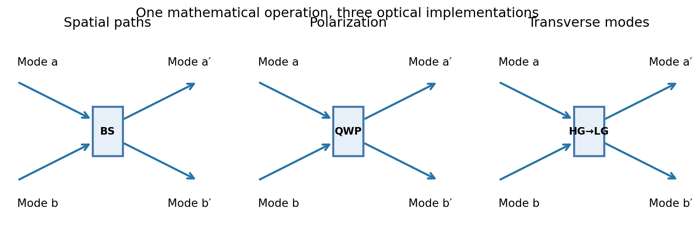
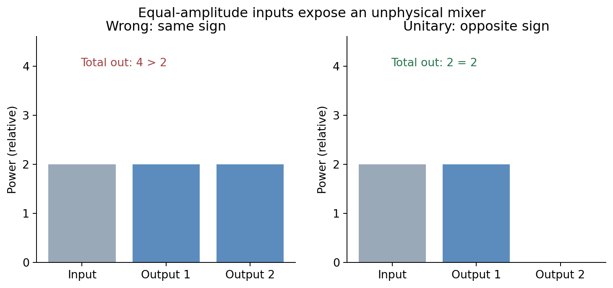
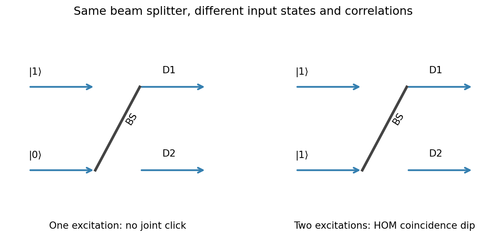

# Post 3 — Working Outline

**Status:** Story and physics development; not article prose. **Title/subtitle:** Open.

**Working theme:** A click is not proof of a photon. The difference between classical and quantum light emerges when we compare detection events. The same lossless mode mixing familiar from classical optics then reveals quantum correlations.

## Pixar Arc

- **Once upon a time:** Quantum matter interacting with a classical electromagnetic field explains discrete photo-detection events, including the photoelectric effect in a semiclassical treatment.
- **Every day:** A single detector clicks at random times. The click alone does not tell us whether the incoming field was quantized.
- **One day:** We compare detections across modes. Before doing quantum mechanics, revisit the common classical mathematics of beam splitters, polarization conversion, and HG-to-LG conversion.
- **Because of that:** A lossless linear transformation must be unitary. Promote amplitudes to mode operators; the same transformation preserves their commutators. Apply it to photon-number states: single-photon antibunching and two-photon HOM interference.
- **Until finally:** Correlations can be spatial or temporal. Introduce the meaning of second-order correlation measurements and their classical bound; this opens the question of how different *states* of light behave, reserved for Post 4.
- **Since then / horizon:** Nonclassical interference and correlations underpin photonic quantum information, including interferometric quantum computing and teleportation protocols; mention without suggesting a beam splitter alone provides those capabilities.

## Proposed Sections (Provisional)

### 1. A Click Is Not Proof of a Photon

- Continue directly from the closing paragraph of Post 2.
- Semiclassical model: classical light, quantized matter/detector; random clicks follow intensity.
- Motivate correlations instead of claiming that every single-mode measurement is classical.
- **Open:** How much of the photoelectric-effect argument to revisit? Probably a compact recap, not a new historical excursus.

### 2. Different Devices, the Same Mode Mixing

- Classical complex amplitudes as a two-component vector.
- Examples: spatial-path beam splitter, linear-to-circular polarization using a retarder, HG-to-LG conversion from Post 1.
- General lossless map: `c_out = U c_in`.
- **Figure 1** below.
- **Open:** Whether to introduce the general 2×2 matrix before or after showing the three examples; current preference is examples leading into the matrix.

### 3. What Goes Wrong Without Unitarity?

- Deliberately wrong equal-sign splitter: `(1/sqrt(2)) [[1,1],[1,1]]`.
- One input seems fine; two equal inputs generate twice the incoming total power.
- Repair with opposite relative phase; derive `U†U = I` for *all* inputs, not merely a selected illumination.
- Keep **strictly lossless**; no absorption, loss ports, or environmental-mode detour.
- **Figure 2** below.

### 4. Quantizing a Familiar Transformation

- Replace mode amplitudes with annihilation operators; use `a_out = U a_in` with an explicitly consistent operator convention.
- Show `U U† = I` preserves `[a_i,a_j†] = δ_ij` (equivalent to `U†U=I` for square U).
- Derive a passive coupling Hamiltonian such as `H = ħg(a†b+b†a)` as a generator of mode exchange, noting that relative-phase devices have a different generator within the same passive-unitary family.
- **Open:** How much Hamiltonian derivation fits the depth of Posts 1–2? Prefer one short, motivated derivation rather than a general SU(2) treatment.

### 5. One Photon, Two Detectors

- Apply the splitter to `|1,0⟩`; one excitation is distributed over two output possibilities.
- Show why ideal single-photon input cannot give two simultaneous detections, then make the **classical comparison quantitative**: `g²(0) < 1` cannot arise from a classical stochastic intensity under standard semiclassical photodetection assumptions.
- Important: *absence of raw coincidences alone* is not a robust quantum test without normalized rates and controls.
- **Figure 3**, left.

### 6. Two Photons: The Hong–Ou–Mandel Effect

- Input `|1,1⟩` to a balanced beam splitter; amplitudes for the two ways to get one photon in each output cancel.
- Result, up to phase conventions: `(|2,0⟩ − |0,2⟩)/sqrt(2)`.
- Contrast with two photons entering one port, and with distinguishable arrivals.
- Distinguish genuine two-photon Fock-state predictions from classical-wave analogues of some HOM-shaped dips.
- **Figure 3**, right; possibly a separate delay-versus-coincidence plot in the final article.
- **Open:** How much to revisit the author's earlier HOM article versus linking to it and focusing on the Hamiltonian / mode perspective?

### 7. Correlations Across Space and Time

- From cross-mode coincidences to delayed correlations `g²(τ)`.
- Define operationally as normalized probability of a second click at delay τ, with an appropriate stationary-field definition.
- Antibunching as a nonclassical signature; distinguish it from ordinary random detector clicks.
- Mention photon bunching and phase-sensitive correlations as the motivation for classifying states in Post 4; **do not** develop coherent/thermal/squeezed states here.
- **Open:** Derive the classical zero-delay bound explicitly here or in a small boxed argument? Current preference: derive it.

## Draft Figures and Intended Captions

### Figure 1 — Three Implementations of Two-Mode Mixing

**Intended caption:** A beam splitter mixes spatial paths, a wave plate changes relative phases of polarization components, and a cylindrical-lens converter transforms superpositions of HG modes into LG modes. These devices are not identical optical elements; they illustrate different members of the same family of lossless two-mode unitary transformations. **Final figure:** replace generic boxes with physically meaningful schematics and show representative complex amplitudes/relative phases.

### Figure 2 — The Splitter That Creates Energy

**Intended caption:** A naive matrix with identical rows seems to split a single input correctly, but equal inputs yield output power 4 from input power 2. Changing a relative sign restores conservation: interference redirects energy instead of creating it. **Final figure:** display the two matrices and the input/output field arrows alongside power bars; current bars are only placeholders.

### Figure 3 — One Photon Versus Two

**Intended caption:** The same balanced beam splitter is tested with one photon in one input and with one photon in each input. The first reveals the absence of same-event joint clicks for an ideal single photon; the second produces destructive interference of the coincidence amplitudes when photons are indistinguishable. **Final figure:** distinguish output alternatives explicitly and possibly add a HOM delay scan; avoid implying that a zero raw coincidence count alone proves nonclassicality.

## Open Editorial / Physics Decisions

- Working title and subtitle are undecided.
- Whether to add a separate figure for `g²(τ)` or reuse the experimental figure.
- Exact depth of coupling-Hamiltonian derivation.
- How much HOM exposition to repeat from the previously published article.
- How far to go into temporal correlation theory before handing off to Post 4.
- Quantum-information applications: a brief closing consequence, not an unearned claim of universal capability.

## Handoff to Post 4

Photon counting and correlations distinguish some states of light, but do not completely specify their phase-space structure. What does a state of light actually look like, and why does a laser produce one that appears almost classical?
