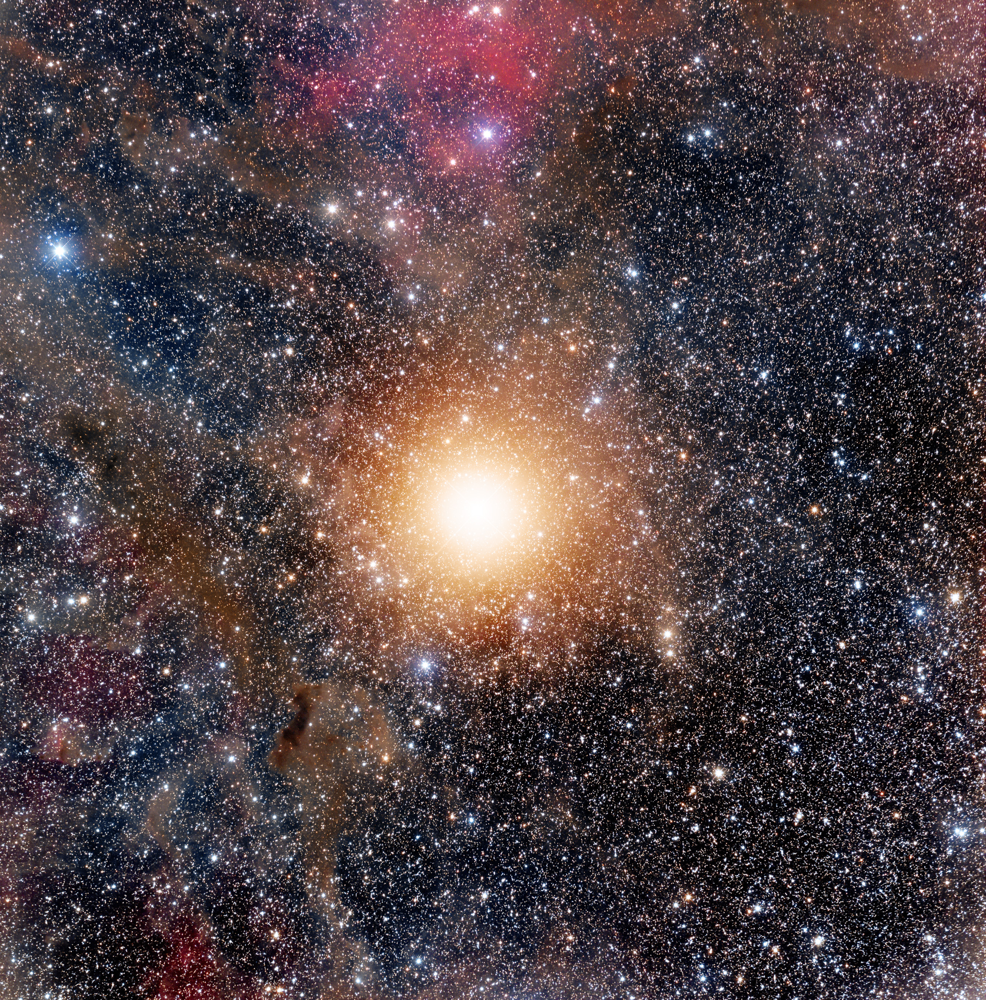
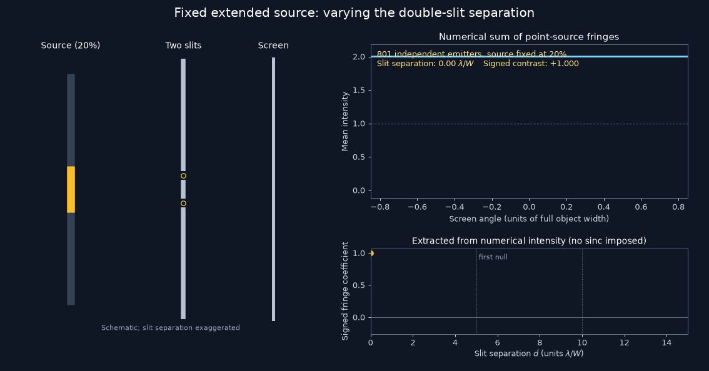
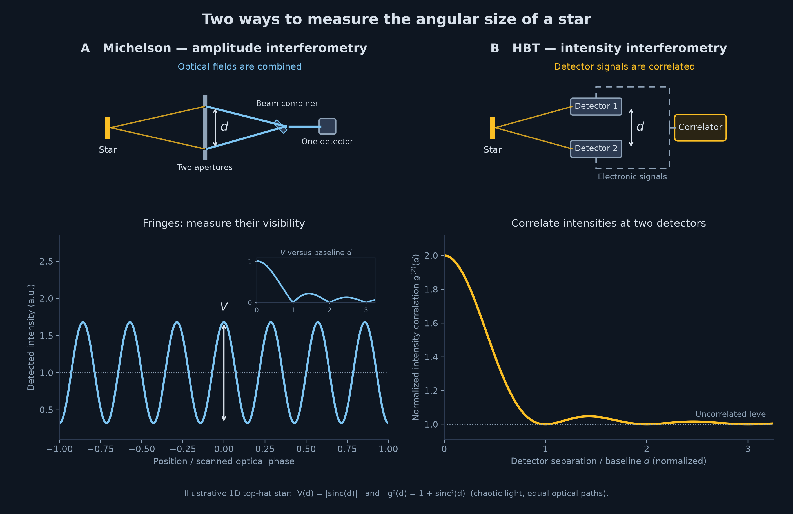
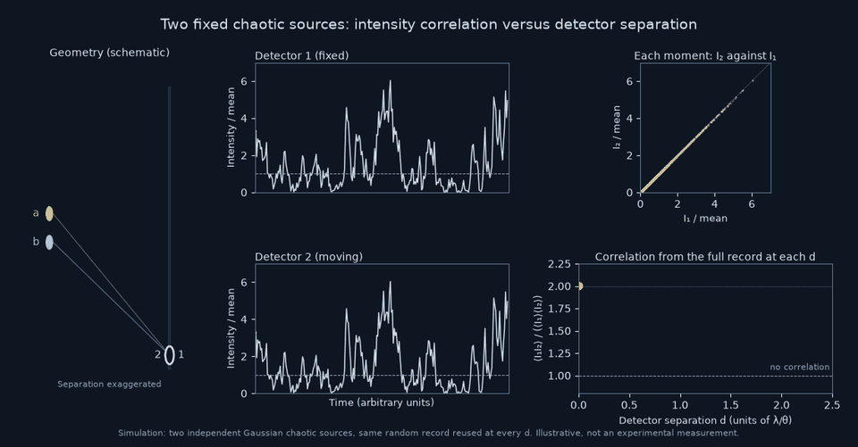
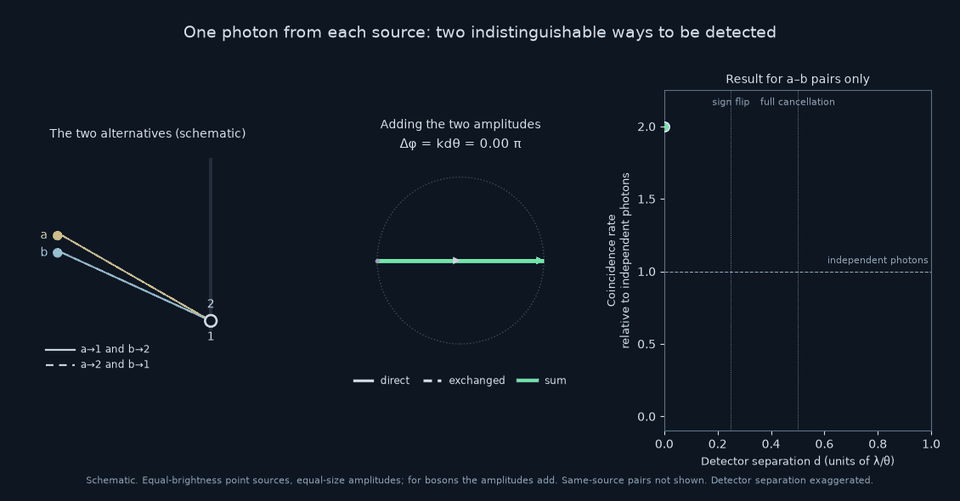
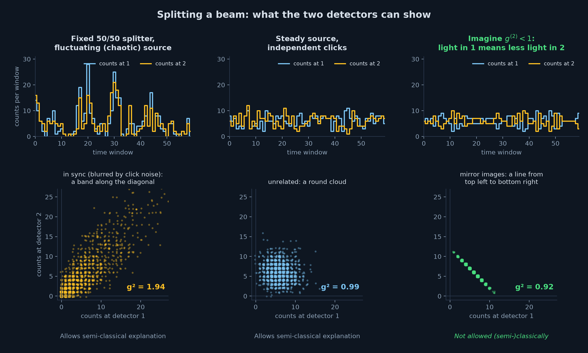
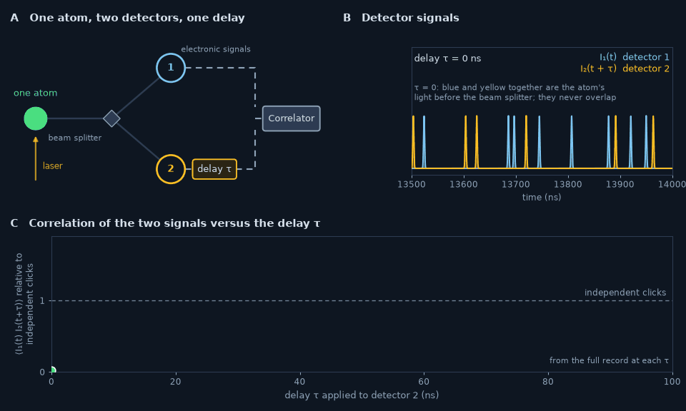

# They Wanted to Measure a Star. They Ended Up Questioning the Photon.
## Hanbury Brown and Twiss measured stars with correlations, sparked a controversy over photons, and set the stage for quantum optics.

> Caption: **Betelgeuse**
> Alt text: Telescope photograph of the night sky with many stars and other objects. Betelgeuse is a very bright, relatively large object at the centre of the image.
> Source: Adam Block, Mount Lemmon SkyCentre, University of Arizona. Used with permission.

A photodetector clicks, and each click is a discrete event. It is tempting to read it as a photon arriving. But if we treat the light as a classical wave and only the detector quantum mechanically (the semiclassical picture), the clicks will still appear. They come at random times, at a rate set by the intensity of the light. The discreteness can come from the detector rather than from the light.

A bright wave gives many clicks, a weak wave few, and a fluctuating wave gives click rates that follow its fluctuations. The main features of the photoelectric effect, the historical argument for photons, can be explained in this way [1]. So the clicks themselves, and the rate at which they arrive, do not require a quantum theory of light.

> **Individual Clicks Don’t Prove Light Is Quantum**

Then what would? Not the clicks of a single detector, but how clicks at different times and places are related to each other: their correlations. These turned up first in an unexpected place, the measurement of the size of a star.

## It All Started with Measuring a Star

A star is so far away that even a large telescope shows it as a point of light. Add atmospheric turbulence and measuring the size of a star directly becomes impossible. Already in the nineteenth century, Hippolyte Fizeau suggested using interference. Every point on the star creates a fringe pattern behind a double slit, shifted slightly depending on its position. Different points on the star emit independently, so the detector adds the intensities of all these patterns. For a source of angular width *w* there is a specific slit separation *d* at which the fringes disappear for the first time. For slightly shorter and slightly larger separations they are visible, so the disappearance is a sharp feature that is (relatively) easy to locate. So, scan the slit separation until the fringes become invisible, and you can determine the angular size of the source. The wider the source, the smaller that separation.

It took until 1920 for this idea to be put into practice. At Mount Wilson in California, Michelson and Pease added a stellar interferometer to the new 100-inch telescope. They aimed it at Betelgeuse, in Orion, and for the first time measured the angular diameter of a star other than the Sun [2].

> Caption: **Figure 1. Michelson's method for measuring the angular diameter of a star. Light from different points on the stellar disk produces slightly shifted interference fringes. As the separation between the two apertures increases, the combined fringes lose contrast. The first disappearance reveals the star's angular diameter.**
> Alt text: Animation of an extended star observed through two apertures. As the separation between the apertures increases, the interference pattern changes and a plot of fringe contrast falls, until the fringes disappear at a separation that gives the star's angular diameter.
> Source: Image by author.

## A New Way to Measure Starlight

Before and after the Second World War, radio astronomy flourished. As in optical astronomy, radio astronomers wanted a way to measure the angular diameter of celestial sources. Using the principle of Michelson and Pease would mean combining the radio waves from two antennas far apart, with long cables whose phase had to stay stable, while the ionosphere kept disturbing that phase. Hanbury Brown and Twiss (HBT) proposed to skip the optical combination and move to what they called “intensity interferometry” [3, 4]. Rather than two slits with one detector, they used two detectors at a certain distance, and compared the intensity signals.

> Caption: **Figure 2. Two ways to measure the angular size of a star. Michelson combines the light from two apertures and measures interference fringes. Hanbury Brown and Twiss measure correlations between the signals of two separated detectors, without combining the light optically.**
> Alt text: Comparison of Michelson and Hanbury Brown–Twiss interferometers observing an extended star. In the Michelson arrangement, light collected at two apertures is combined to produce interference fringes. In the HBT arrangement, two separated detectors record the intensity independently and their signals are correlated.
> Source: Image by author.

Starlight is chaotic: its intensity flickers randomly, so each detector produces what looks like noise. The question is whether the correlation between these two noisy signals carries relevant information.

Take a simple case, two independent point sources *a* and *b* a small angle θ apart. Each detector receives light from both sources: the field at each detector contains a contribution from *a* and one from *b*. The resulting correlation depends on the geometric phase difference between the light from *a* and from *b*. That phase difference is related to their angular separation.

> **Michelson used interference to measure a star. HBT discovered that correlations could do the same job.**

The correlation between the two signals oscillates with the detector separation: it is largest when the detectors sit on top of each other, falls to the level of unrelated signals, and returns to its maximum after one period. The period tells us the angular separation of the sources. For an extended source the oscillations wash out, and the first drop to the unrelated level gives its size (for a source of known shape, such as a uniform disk), just as the first disappearance of the fringes did for Michelson.

> Caption: **Figure 3. For two independent point sources, the correlation between two detectors oscillates as their separation changes. The period is determined by the angular separation of the sources. For an extended source, contributions from many points wash out the oscillations, allowing its angular size to be determined.**
> Alt text: Animated simulation of two independent chaotic point sources illuminating two detectors. As detector separation changes, the intensity traces become more or less correlated, the scatter plot of their instantaneous values changes shape, and the normalized correlation oscillates between approximately 1 and 2.
> Source: Image by author.

## Photons Aren’t Supposed to Arrive Together. Or Are They?

HBT quickly realized that their intensity interference was relevant not only for radio waves, but would also work for optical sources. To test it in the laboratory, they used light from a mercury vapour lamp. The title of their 1956 paper was “Correlation between photons in two coherent beams of light” [5]. Where before we spoke about waves, we now bring photons into the game. Other scientists, most prominently Brannen and Ferguson, stated that such a correlation, if it existed, would call for a major revision of fundamental concepts in quantum mechanics. Their own experiment found no correlation [6]. A controversy was born.

> **The classical calculation was never in doubt: the photon picture was.**

Edward Purcell, who had shared the Nobel Prize in Physics for nuclear magnetic resonance, stepped in. He argued that the two experiments were not in conflict, because the effect is small and, due to their setup, Brannen and Ferguson’s apparatus could not have seen it. And the effect, far from requiring a revision of quantum mechanics, is an instructive illustration of its elementary principles [7]. As he wrote to Brannen: “Talking about interference of photons is the easiest way to go astray in such matters. […] The electromagnetic field is a classical field after all, which is why the Brown–Twiss effect only appears odd if one looks at it from a particle point of view; its oddness being simply the peculiarity of bosons” [8].

So the controversy was to a large extent about the intuitive picture of a photon as a particle. Or, as HBT wrote of Brannen and Ferguson’s mistake: “The error appears to have arisen because of a too literal reliance on the corpuscular picture of light” [9].

So how do we explain the HBT effect in a photon picture?

## Why Photons Bunch

In HBT we see the effect as a correlation between detectors at different locations: a correlation in space. The same effect shows up as a correlation between measurements at different moments, a correlation in time. In the photon picture, if each photon arrived independently there would be no correlations. The HBT signal shows that photons tend to group together. Purcell called this clumping [7]; the term we use more commonly is bunching. For chaotic light, the bosonic nature of photons explains this. One way to see how this gives information on the size of a source is the following argument.

Take two independent sources *a* and *b*, and detectors 1 and 2. A coincidence with one photon from each source can come about in two ways: *a* is detected at 1 and *b* at 2, or *a* at 2 and *b* at 1. If nothing tells us which of the two happened, they are not separate events, and their amplitudes add: they can strengthen or cancel each other. Note the subtlety: this is not interference of photons with each other, but of the amplitudes of two indistinguishable alternatives that lead to the same outcome. The relative phase between them is geometrical, set by the difference between the extra paths to detector 2 from *a* and from *b*; it equals *kd*θ. The random phases of the sources are the same in both alternatives and drop out.

Adding the two amplitudes gives a cross-source contribution that varies as 1 + cos(*kd*θ). It is twice the independent value when the detectors sit on top of each other, zero at half a period, and back to twice after a full period. This two-photon interference is only one part of all coincidences that can occur. For independent chaotic sources like these, photons from the same source also coincide, independent of *d*, so the *d*-dependent signal comes on top of a constant baseline.

> Caption: **Figure 4. A coincidence between two detectors can arise in two indistinguishable ways: a photon from source a reaches detector 1 and one from b reaches detector 2, or the other way around. Their probability amplitudes interfere, producing a correlation that depends on the path-length differences.**
> Alt text: Two diagrams showing sources a and b and detectors 1 and 2. In the first, paths connect a to detector 1 and b to detector 2. In the second, the connections are exchanged. Both alternatives produce one detection at each detector.
> Source: Image by author.

## Two Explanations, One Effect

With the work of Purcell, Mandel and others, the classical description and the quantum view were reconciled [7, 8, 10]. What a classical wave source describes as correlated intensity fluctuations of chaotic light, the quantum picture describes as bunched photons. The HBT effect also triggered further development of how correlations are described in the quantum framework. So bunching, however it is described, does not show that light is quantum: a classical fluctuating wave and a click rate that follows its intensity are enough.

> **Purcell explained why the resulting bunching did not contradict quantum mechanics. But that does not mean we need quantum mechanics to explain the HBT effect.**

But this triggers a question: if photons can bunch, could they also antibunch? Can we imagine a scheme where photons arrive more regularly than random? If that is possible, it would be an effect that cannot be explained classically. A true signature of the quantum nature of light.

## What If Photons Avoid Each Other Instead?

To compare bunching and antibunching we need one number. We express the correlation as g⁽²⁾: g⁽²⁾(d) for two detectors a distance *d* apart, or g⁽²⁾(τ) for clicks separated by a delay τ. In the semiclassical description, it is the average of the product of the two intensities at different moments or positions, I₁I₂, divided by the product of their averages. In the notation, the (2) makes clear that it is not a square, but a second-order correlation.

For unrelated signals it equals 1. Unrelated can be signals from independent sources, but can also be signals from the same source with a large time difference. So, for the sources considered here, g⁽²⁾(τ) approaches 1 once τ is much longer than their correlation time. At zero time difference, or when the detector positions overlap, we can write for a classical stochastic intensity

$$
g^{(2)}(0)
=\frac{\langle I^2\rangle}{\langle I\rangle^2}
=1+\frac{\operatorname{Var}(I)}{\langle I\rangle^2}
\geq1.
$$

For a constant intensity (to a good approximation a laser), ⟨*I*²⟩ = ⟨*I*⟩² and g⁽²⁾(0) = 1. For chaotic light, whose intensity is exponentially distributed, ⟨*I*²⟩ = 2⟨*I*⟩² and g⁽²⁾(0) = 2. Since the variance of a classical intensity is never negative, g⁽²⁾(0) is always equal to or larger than 1. Note what this bound covers: the correlation of a classical intensity with itself at zero delay, or equivalently the two outputs of a 50/50 splitter illuminated by the same classical source. It does not forbid two unrelated classical signals from being anticorrelated.

Let's for now ignore that limitation and look at what it means for g⁽²⁾ to be larger than, equal to, or smaller than 1. Figure 5 shows the three cases. All three sources have approximately the same average photon count, but their fluctuations differ.

In the first case, detector 2 sees the same signal (the splitter splits the incoming light into two equal beams) and g⁽²⁾ > 1. In the middle panel, the signal at detector 2 is not correlated to that at detector 1, as if the light came from independent sources, or as if the noise came from the independent detection process at each detector (g⁽²⁾ = 1). In the third case, the signal at detector 2 has the opposite fluctuations from detector 1: if one goes high, the other goes low (and vice versa) (g⁽²⁾ < 1). With a passive beam splitter, this cannot be explained in a classical model. The light, and not only the detector, would have to be quantized. A stream of photons that arrive at regular spacing, each going to one detector or the other, would give exactly this signal. This would be a true quantum effect, beyond the semiclassical interpretation. But is this a figment of the imagination, or could this type of light really be made?

> Caption: **Figure 5. Photon counts in equal time windows at two detectors behind a 50/50 beam splitter. Left: chaotic light produces positively correlated counts (g⁽²⁾ > 1). Middle: a steady coherent source produces independent Poissonian counts (g⁽²⁾ = 1). Right: a source with approximately fixed photon number per window produces anticorrelated counts (g⁽²⁾ < 1). The last case cannot be reproduced by splitting a classical fluctuating intensity. The right panel is an illustration; the real experiment is shown in Figure 6.**
> Alt text: Three panels compare photon counts recorded by two detectors over successive time windows. In the first, the two count traces rise and fall together. In the second, their fluctuations are unrelated. In the third, higher counts in one detector correspond to lower counts in the other.
> Source: Image by author.

## When Photons Avoid Each Other, Classical Physics Falls Short

A source with a nearly fixed number of photons per time window is only one way to get g⁽²⁾ smaller than 1. Could photons also avoid arriving close together in time? Imagine a single atom as a light source. The atom is excited by a laser and produces a photon when it falls back to the ground state. Right after emitting, it cannot emit again: it first has to be excited again, which typically takes nanoseconds. Such an isolated atom would produce an antibunched photon stream, with g⁽²⁾ smaller than 1.

> **And Kimble, Dagenais and Mandel finally measured a correlation that could not be explained without quantizing the light itself.**

In 1977, Kimble, Dagenais and Mandel at the University of Rochester did the experiment [11]. A laser beam crossed a thin beam of sodium atoms, so thin that only one or two atoms were in the field of view at any moment. They used a beam splitter to split the light from the atoms to two detectors. One detector started a timer upon detecting a photon, the other stopped the timer. After normalization, the histogram of the measured delays gives g⁽²⁾(τ). Figure 6 shows the idea: one atom, a beam splitter, two detectors, and the correlation built up one delay at a time. They found the fewest pairs at zero delay, and more and more pairs as the delay grew. Corrected for stray laser light, g⁽²⁾ at zero delay came out at about 0.4 (not 0, probably because sometimes more than one atom radiated). This was a clear experimental result that could not be explained by treating light as a classical wave. Kimble, Dagenais and Mandel were the first to observe photon antibunching: direct evidence that the light itself has to be quantized.

> Caption: **Figure 6. A single atom emits photons that are divided between two detectors by a beam splitter. Each detection at the first detector starts a timer; a detection at the second stops it. Accumulating many delays reveals a dip in the coincidence rate near zero delay: immediately after emitting a photon, the atom must be excited again before it can emit another. For an ideal single atom the dip reaches zero; Kimble, Dagenais and Mandel measured about 0.4.**
> Alt text: Animated diagram of a single atom emitting light toward a beam splitter and two photon detectors. Detection events trigger a timer, and a histogram of time delays gradually builds up. The resulting distribution shows fewer coincidences near zero delay and more at longer delays.
> Source: Image by author.

## Quantum Optics

In this discussion of the HBT effect we have alternated between light as a wave, light as a stream of indivisible particles, and the bosonic picture in which detector clicks tend to group together. At the time of this story these intuitions co-existed, and Hanbury Brown and Twiss themselves appealed to Bohr’s complementarity: a given experiment can show the wave aspect of light or the particle aspect, but not both [9]. The HBT effect and the controversy around it forced sharper thinking about light as a quantum phenomenon. As we have seen, it prepared the way for experiments on states of light that have no (semi)classical explanation. Some consider this episode the beginning of quantum optics. The first lasers, in 1960, made the question urgent: what are the correlations of photons in a laser beam? The theory of quantum optics was developed by Glauber [12, 13]. In his Nobel lecture he describes the HBT correlation as something altogether new that called for a clear explanation. Of Dirac’s remark that a photon only interferes with itself, he writes: “It is not the photons that interfere physically, it is their probability amplitudes that interfere” [12]. The HBT puzzle set him on the path to the theory that describes the difference between thermal light and laser light.

And what happened to the ambition of HBT to measure stars? From the lab they took the optical measurements back outside. In the [brutal winter](https://youtu.be/ZPOtDY3mQYc?si=agDthwP6EYby4W43) of 1955–56, with two army searchlight mirrors and mostly poor weather, they measured the angular diameter of Sirius [14, 15]. Five months of observing added up to only 18 hours. From this success they went on to build the Narrabri Stellar Intensity Interferometer in Australia: two mirrors of 6.7 metres on a circular track 188 metres across [15]. It measured the angular diameters of hot, bright stars such as Vega, β Crucis and Altair, which Michelson’s interferometer could not reach [15, 16].

In the next post we follow Glauber and look at the different states of light, and how they fit into one all-encompassing theory.

Leave a comment, and do not forget to subscribe.

## References

1. Lamb, W. E. and Scully, M. O. (1969). The photoelectric effect without photons. In *Polarisation, Matière et Rayonnement* (Jubilee volume in honour of Alfred Kastler), Presses Universitaires de France, Paris, 363–369.
2. Michelson, A. A. and Pease, F. G. (1921). Measurement of the diameter of α Orionis with the interferometer. *Astrophysical Journal* **53**, 249–259.
3. Hanbury Brown, R., Jennison, R. C. and Das Gupta, M. K. (1952). Apparent angular sizes of discrete radio sources. *Nature* **170**, 1061.
4. Hanbury Brown, R. and Twiss, R. Q. (1954). A new type of interferometer for use in radio astronomy. *The London, Edinburgh, and Dublin Philosophical Magazine and Journal of Science* **45**(366), 663–682. https://doi.org/10.1080/14786440708520475
5. Hanbury Brown, R. and Twiss, R. Q. (1956). Correlation between photons in two coherent beams of light. *Nature* **177**, 27.
6. Brannen, E. and Ferguson, H. I. S. (1956). The question of correlation between photons in coherent light rays. *Nature* **178**, 481.
7. Purcell, E. M. (1956). The question of correlation between photons in coherent light rays. *Nature* **178**, 1449.
8. Silva, I. and Freire, O. Jr. (2013). The concept of the photon in question: the controversy surrounding the HBT effect circa 1956–1958. *Historical Studies in the Natural Sciences* **43**(4), 453–491. https://doi.org/10.1525/hsns.2013.43.4.453 (Purcell's letter to Brannen is quoted on p. 477.)
9. Hanbury Brown, R. and Twiss, R. Q. (1957). Interferometry of the intensity fluctuations in light. I. Basic theory: the correlation between photons in coherent beams of radiation. *Proceedings of the Royal Society of London A* **242**, 300–324. (The quotation about the “corpuscular picture” and the statement of Bohr’s complementarity are on pp. 300–301.)
10. Mandel, L. (1958). Fluctuations of photon beams and their correlations. *Proceedings of the Physical Society* **72**, 1037–1048.
11. Kimble, H. J., Dagenais, M. and Mandel, L. (1977). Photon antibunching in resonance fluorescence. *Physical Review Letters* **39**, 691–694.
12. Glauber, R. J. (2006). Nobel Lecture: One hundred years of light quanta (delivered 8 December 2005). *Reviews of Modern Physics* **78**(4), 1267–1278. https://doi.org/10.1103/RevModPhys.78.1267
13. Glauber, R. J. (1963). The quantum theory of optical coherence. *Physical Review* **130**, 2529–2539.
14. Hanbury Brown, R. and Twiss, R. Q. (1956). A test of a new type of stellar interferometer on Sirius. *Nature* **178**, 1046–1048.
15. Hanbury Brown, R. (1966). The stellar interferometer at Narrabri, Australia. I. The principles of the intensity interferometer; general description. *Philips Technical Review* **27**(6), 141–152.
16. Hanbury Brown, R., Davis, J. and Allen, L. R. (1967). The stellar interferometer at Narrabri Observatory – I. A description of the instrument and the observational procedure. *Monthly Notices of the Royal Astronomical Society* **137**, 375–392.

<!--
METADATA
date: 2026-10-19
revision: 1

medium:
  topics:
    - Physics
    - Quantum Physics
    - Optics
    - Astronomy
    - Science
  seo_title: How Measuring a Star Led to Questioning the Photon
  seo_description: Hanbury Brown and Twiss measured stars with intensity correlations and sparked a controversy over photons. Photon antibunching later showed light must be quantized.
  preview_title: They Wanted to Measure a Star. They Ended Up Questioning the Photon.
  preview_subtitle: From measuring stars to doubting the photon
  publication: Science Spectrum
  canonical_url: "None"
-->