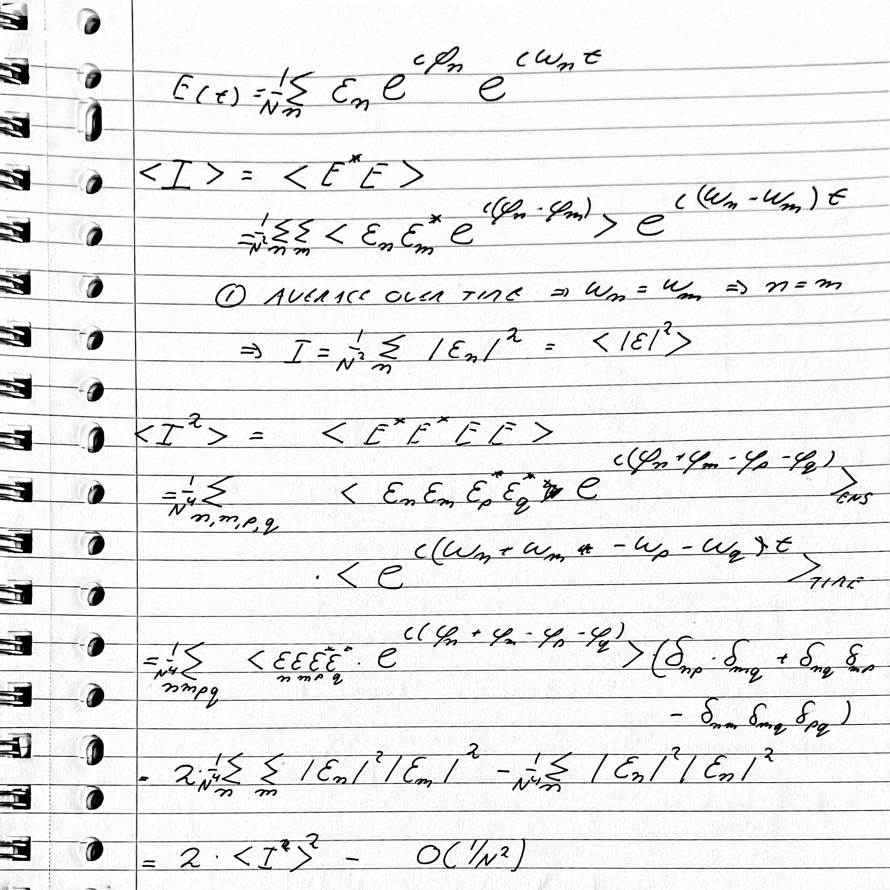

# $g^{(2)}(0)$ for light made of $N$ modes with random phases

Transcribed from handwritten notes. Points where I changed or questioned the notes are collected in the "Remarks" section at the end and marked **[R1]–[R5]** in the text.

## Setup

$$
E(t)=\frac1N\sum_{n}\varepsilon_n\,e^{i\varphi_n}\,e^{i\omega_n t}
$$

- fixed amplitudes $\varepsilon_n$
- independent, uniformly distributed random phases $\varphi_n$
- distinct, generic frequencies $\omega_n$ (no accidental relations among them)

Two averages appear: the ensemble average over the phases, $\langle\cdot\rangle_{\rm ENS}$, and the time average, $\langle\cdot\rangle_{\rm TIME}$.

## 1. Mean intensity

$$
\langle I\rangle=\langle E^*E\rangle
=\frac1{N^2}\sum_{n}\sum_{m}\bigl\langle\varepsilon_n\varepsilon_m^*\,e^{i(\varphi_n-\varphi_m)}\bigr\rangle\,e^{i(\omega_n-\omega_m)t}.
$$

**① Time average.** For $n\ne m$ the exponential oscillates and averages to zero, so

$$
\langle e^{i(\omega_n-\omega_m)t}\rangle_{\rm TIME}=\delta_{nm}
\quad\Longrightarrow\quad
\langle I\rangle=\frac1{N^2}\sum_n|\varepsilon_n|^2 .
$$

**[R1]** With $\langle|\varepsilon|^2\rangle\equiv\frac1N\sum_n|\varepsilon_n|^2$, this equals $\langle|\varepsilon|^2\rangle/N$, not $\langle|\varepsilon|^2\rangle$. See the remarks.

## 2. The four-field average

$$
\langle I^2\rangle=\langle E^*E^*EE\rangle
=\frac1{N^4}\sum_{n,m,p,q}
\bigl\langle\varepsilon_n\varepsilon_m\varepsilon_p^*\varepsilon_q^*\,e^{i(\varphi_n+\varphi_m-\varphi_p-\varphi_q)}\bigr\rangle_{\rm ENS}\;
\bigl\langle e^{i(\omega_n+\omega_m-\omega_p-\omega_q)t}\bigr\rangle_{\rm TIME}.
$$

**Time average.** It gives a Kronecker delta enforcing

$$
\omega_n+\omega_m=\omega_p+\omega_q .
$$

**[R3]** For generic frequencies this condition has only two kinds of solution, the two pairings

$$
(n=p,\ m=q)\qquad\text{and}\qquad(n=q,\ m=p),
$$

and they coincide when all four labels are equal. Counting that case once (inclusion–exclusion):

$$
\bigl\langle e^{i(\omega_n+\omega_m-\omega_p-\omega_q)t}\bigr\rangle_{\rm TIME}
\;\to\;\delta_{np}\delta_{mq}+\delta_{nq}\delta_{mp}-\delta_{nm}\delta_{mq}\delta_{pq}.
$$

**Phase average.** On these index choices each phase appears once with $+$ and once with $-$, so $e^{i(\varphi_n+\varphi_m-\varphi_p-\varphi_q)}=1$ and the ensemble average is trivial.

**Result.**

$$
\langle I^2\rangle=\frac1{N^4}\Bigl[\,2\sum_n\sum_m|\varepsilon_n|^2|\varepsilon_m|^2-\sum_n|\varepsilon_n|^4\Bigr].
$$

## 3. Expressed through $\langle I\rangle$

The first term is $2\bigl(\sum_n|\varepsilon_n|^2\bigr)^2/N^4=2\langle I\rangle^2$, so

$$
\langle I^2\rangle=2\langle I\rangle^2-\frac1{N^4}\sum_n|\varepsilon_n|^4 .
$$

**[R2]** Normalizing,

$$
\boxed{\,g^{(2)}(0)=\frac{\langle I^2\rangle}{\langle I\rangle^2}
=2-\frac{\sum_n|\varepsilon_n|^4}{\bigl(\sum_n|\varepsilon_n|^2\bigr)^2}
=2-\frac{\langle|\varepsilon|^4\rangle}{N\,\langle|\varepsilon|^2\rangle^2}\,}
$$

For $N$ equal amplitudes this is $2-1/N$. It equals 1 for a single line and tends to 2 for many lines.

## Remarks

**[R1] Normalization of $E$.** With the prefactor $1/N$ the mean intensity scales as $\langle I\rangle=\langle|\varepsilon|^2\rangle/N$. If you want $\langle I\rangle=\langle|\varepsilon|^2\rangle$ as in the notes, use $E=\frac1{\sqrt N}\sum_n\varepsilon_ne^{i\varphi_n}e^{i\omega_nt}$. Then $\langle I\rangle=\langle|\varepsilon|^2\rangle$ and

$$
\langle I^2\rangle=2\langle I\rangle^2-\frac{\langle|\varepsilon|^4\rangle}{N}.
$$

$g^{(2)}(0)$ does not depend on the normalization.

**[R2] Size of the correction.** The last line of the notes reads "$2\langle I\rangle^2-O(1/N^2)$" (I read the first factor as $\langle I\rangle^2$; if the notes have $\langle I^2\rangle^2$, that is a slip). With the $1/N$ normalization used in the notes, the correction is $\langle|\varepsilon|^4\rangle/N^3$, while $\langle I\rangle^2=\langle|\varepsilon|^2\rangle^2/N^2$. So the correction is of relative size $1/N$, and it is not $O(1/N^2)$. A statement that holds in both normalizations is

$$
\langle I^2\rangle=2\langle I\rangle^2\Bigl[1-O(1/N)\Bigr].
$$

**[R3] Generic frequencies.** The step from "$\omega_n+\omega_m=\omega_p+\omega_q$" to the two pairings assumes no accidental coincidences. For a continuum, or for equally spaced lines (a comb), many other index combinations satisfy the condition. Then the time average alone does not select the pairings, and the average over independent random phases is what does: it kills every non-paired term. The final result is the same, and the phases then drop out of the surviving terms.

**[R4] Fixed versus Gaussian amplitudes.** In this model each $\varepsilon_n$ is fixed and only the phase is random, which describes a set of laser-like lines. The third (subtracted) term exists only because of that. If each mode amplitude is a complex Gaussian variable (a thermal mode), then $\langle|a_n|^4\rangle=2\langle|a_n|^2\rangle^2$ and the fourth moment is exactly the sum of the two pairings, with no subtraction. Then $g^{(2)}(0)=2$ for any $N$, including $N=1$.

**[R5] Transcription.** In the notes the unconjugated fields carry the indices $n,m$ and the conjugated ones $p,q$. I kept that labelling.

## Next step

With a delay $\tau$ on the second intensity, the pairing of $E^*$ with $E$ at the same time gives $\langle I\rangle^2$ as before. The pairing across the two times gives $\bigl|\sum_n|\varepsilon_n|^2e^{i\omega_n\tau}\bigr|^2/N^4$, so that

$$
g^{(2)}(\tau)=1+|g^{(1)}(\tau)|^2,\qquad g^{(1)}(\tau)=\frac{\sum_n|\varepsilon_n|^2e^{i\omega_n\tau}}{\sum_n|\varepsilon_n|^2}
$$

(for many modes, or Gaussian amplitudes).

