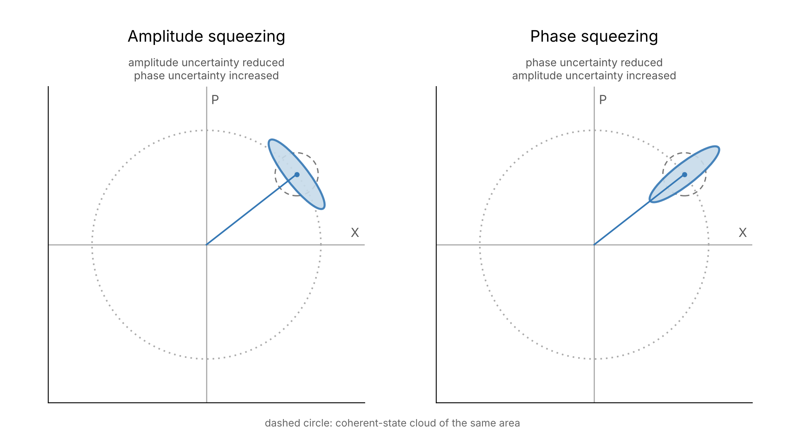
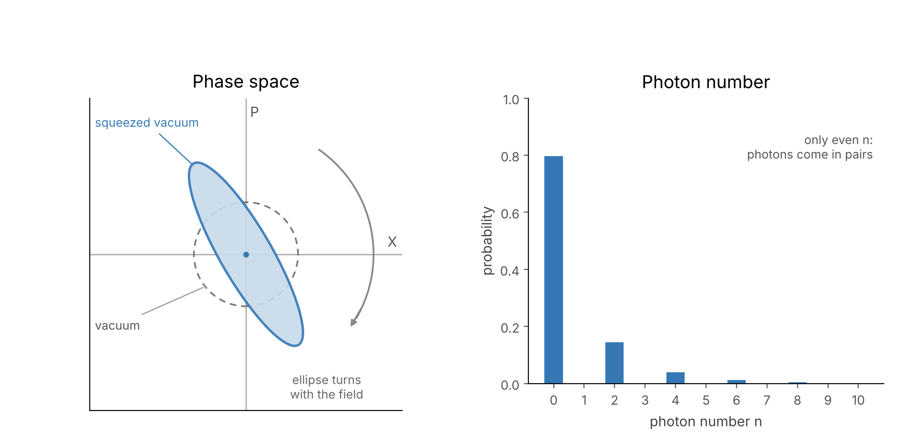
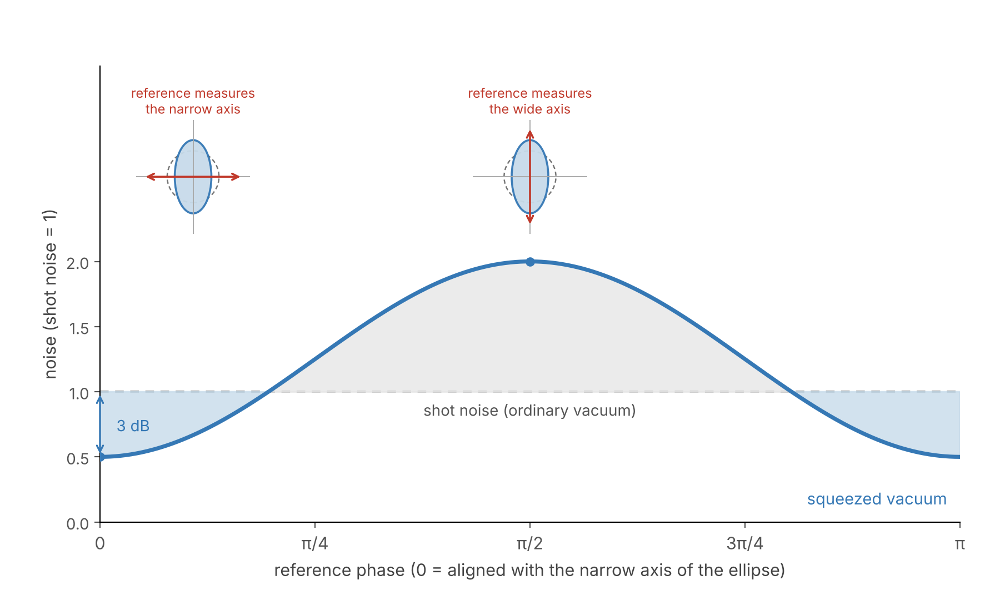

# States of Light
## What Lasers Teach Us About Light—and How That Lets Us Hear Gravitational Waves

> Caption: **Artist's impression of squeezed vacuum.**
> Source: Image generated by author.

In 1960 the first laser was built [1]. As a light source it was remarkably different from the sources traditionally used in optics. These, from lamps to stars, are chaotic: many atoms emit independently, and the beam is a jumble of their contributions. A laser, on the other hand, produces an exceptionally stable and coherent beam.

In the previous post we saw how Hanbury Brown and Twiss revealed correlations in light that ordinary interference experiments could not detect [2]. They called this method “intensity interferometry.” The quantity they measured is the “second-order correlation,” g⁽²⁾(0). The lowest value possible with classical light is 1, and chaotic thermal light typically exceeds this value.

The second-order correlation can be described by fluctuating intensities, caused by physical mechanisms in the source (for instance, thermal fluctuations). An alternative description of these same mechanisms is to say that the photons emitted by the source tend to be “bunched” together: if you detect one photon, it is more likely than average that you detect a second one immediately after. This is not different physics, it is a different interpretation.

So what should we expect from a laser for this correlation? It could behave like the chaotic light of stars, where photons tend to bunch together. It could generate light where photons arrive more regularly than chance would give. Or it could sit exactly on the boundary between the two, where photons arrive independently.

## A Laser Raises a New Question About Light

Before turning to the laser, imagine an “ideal” source that emits photons independently of one another. We split its light equally between two detectors and compare their photon clicks.

From a corpuscular perspective, detecting a photon at one detector tells us nothing about the probability of detecting a photon at the other. The detection events are independent, so their joint probability factorizes into the product of the individual probabilities.

If the probability of a click in a short time interval Δt is approximately IᵢΔt, where Iᵢ is the mean detection rate at detector i, then the probability of a coincidence is

$$
P_{12}\approx (I_1\Delta t)(I_2\Delta t).
$$

For a 50/50 splitter, I₁ = I₂ = I, giving

$$
P_{12}\approx (I\Delta t)^2.
$$

In other words, the coincidence rate contains no excess correlation beyond what we expect from independent detection events. For the detection rate this means

$$
\langle I_1I_2 \rangle = \langle I_1 \rangle\langle I_2 \rangle = \langle I \rangle^2.
$$

The same result follows from a classical wave with constant intensity: splitting it between two detectors produces no intensity correlations.

The second-order correlation g⁽²⁾(0) is the normalized intensity cross-correlation ⟨I₁I₂⟩/(⟨I₁⟩⟨I₂⟩). If the cross term factorizes, g⁽²⁾(0) is equal to one, and we have just seen that this is the case for our ideal source.

In 1951, Roy Glauber, who would spend his career at Harvard, studied a source of radiation whose motion was unaffected by the light it emitted [3]. He found that such a source produces radiation with the same photon statistics we would expect from independent emissions. When the helium-neon laser appeared in 1961 [4], Glauber wondered whether its photons might behave as though they were completely independent [5].

If so, the factorization should not stop at second order. The joint probability of detecting three photons should factorize into three individual probabilities, and similarly for four, five, or any number of detections. For n detectors, we would expect

$$
\langle I_1I_2\cdots I_n\rangle
=
\langle I_1\rangle\langle I_2\rangle\cdots\langle I_n\rangle.
$$

Or, in terms of normalized correlations,

$$
g^{(n)}=1
$$

for every order n.

But what kind of quantum state of light could satisfy this condition?

In 1963, Glauber answered this question by developing a theory of optical coherence [6]. He introduced correlation functions of the electromagnetic field itself. For a fully coherent field, these correlations factorize at every order. Quantum mechanics already contained a natural candidate for such a field: a state that is an eigenstate of the positive-frequency electric-field operator.

$$
E^{(+)}(x)|\psi\rangle=\mathcal E(x)|\psi\rangle.
$$

Here, E⁽⁺⁾(x) is the part of the electric-field operator associated with photon annihilation, while ℰ(x) is an ordinary complex field amplitude. For a single electromagnetic mode, the condition becomes

$$
a|\alpha\rangle=\alpha|\alpha\rangle,
$$

where a is the annihilation operator we introduced in our earlier discussion of quantizing light. Because the state is an eigenstate, each annihilation operator acting on it contributes a complex amplitude, while the corresponding creation operators contribute its complex conjugate when acting on the bra. The normally ordered correlations therefore factorize.

These states are called coherent states, or Glauber coherent states [7].

An ideal laser operating well above its lasing threshold approaches this behavior closely. Coherent states therefore provide a natural quantum description of laser light.

So, what does a coherent state actually look like, and what is left of the quantum world in it?

## Even the Most Classical Light Has Quantum Uncertainty

A single mode of light oscillates at one frequency, and we can describe its state with one complex number, the amplitude *A* of Post 2. We plot *A* in a plane called **phase space** with its real part (X) and imaginary part (P) on the two axes (A = X + iP). As the field oscillates, the point circles the origin once per optical cycle. For the light mode, the two axes are called the field **quadratures**.

The distance of the point from the origin is the field amplitude, whose square is proportional to the intensity. Its angle is the optical phase. A classical wave can be at any point, with a definite amplitude and phase, and the point traces a circle at constant radius.

Glauber’s coherent state follows the same classical motion, but the point becomes a circular uncertainty cloud. The center of the cloud traces the same trajectory as the classical point, with the same mean amplitude and phase. The cloud is the unavoidable quantum uncertainty in the two quadratures: if we measured one of them many times on identically prepared light, the results would scatter over the width of the cloud. For a sufficiently bright field, the width along the radius is the amplitude uncertainty and the width along the circle is the phase uncertainty. For a coherent state the uncertainty is the same in both directions.

Ideal laser light is therefore extraordinarily close to a classical wave. Quantum mechanics does not replace the classical trajectory; it adds irreducible uncertainty around it.

> Caption: **Figure 1. Classical and Coherent Light in Phase Space.** Left: a classical wave is a point circling the origin; its distance from the origin is the amplitude and its angle is the phase. Right: a coherent state follows the same circle, but the point is replaced by a round cloud. The cloud is the minimum quantum uncertainty, the same in every direction, and its size does not grow with the amplitude.
> Source: Image by author.

## One Light Field, Many Quantum States

The coherent state is only one of the many quantum states an electromagnetic mode can occupy. We can compare it with two others: thermal light and photon-number states.

For coherent states, the photon number follows a Poisson distribution: the number of photons fluctuates, but the detections show no excess correlations, so g⁽²⁾(0) = 1.

Thermal light behaves differently. Its photon number fluctuates considerably more than that of a coherent state with the same mean photon number, and the photons tend to arrive in bunches: for a single thermal mode, g⁽²⁾(0) = 2.

At the other extreme, quantum mechanics permits states with an exactly defined number of photons. These are called photon-number states, or Fock states. A Fock state contains precisely n photons, with no uncertainty in photon number. Its second-order correlation is

$$
g^{(2)}(0)=1-\frac{1}{n}.
$$

For a single-photon state, g⁽²⁾(0) = 0: detecting the photon rules out detecting a second one from the same preparation. This is below the classical limit of 1. It is photon antibunching, and no classical intensity fluctuation can produce it.

The coherent state spreads its uncertainty evenly over amplitude and phase. The Fock state has an exactly defined photon number and pays for it with a completely undefined phase. This raises a question: can we choose that balance ourselves, reducing the fluctuations in one property of the field at the cost of increasing them in another?

> Caption: **Figure 2. Three Quantum States of Light.** Three states of a single electromagnetic mode with the same mean photon number. Top: their phase-space distributions—a localized cloud for coherent light, a broad cloud centered on the origin for thermal light, and a ring for a Fock state. Bottom: their photon-number distributions—Poissonian for coherent light, g⁽²⁾(0) = 1; geometric for thermal light, g⁽²⁾(0) = 2; and exactly n photons for a Fock state, g⁽²⁾(0) = 1 − 1/n.
> Source: Image by author.

## What If We Could Squeeze Quantum Uncertainty?

We have seen that a coherent state is represented by a circular uncertainty cloud following the classical trajectory in phase space. But does quantum mechanics require this cloud to be circular? Could we change its shape, making it narrower in one direction and wider in another?

Let's freeze the rotating phase-space picture for a moment, choosing t = 0 when the mean field points along the X axis. At this instant, ΔX describes amplitude fluctuations, while ΔP corresponds to phase fluctuations for a sufficiently bright field. Because X and P do not commute ([X, P] = i/2), we have

$$
\Delta X\,\Delta P\geq\frac14.
$$

For a coherent state, the uncertainties are equal, ΔX = ΔP = ½, and their product is exactly the minimum allowed. But the uncertainty principle constrains the product, not the individual uncertainties. We can compress the cloud in one direction, provided we stretch it sufficiently in the other. For an ideal squeezed state, the uncertainty product remains unchanged:

$$
\Delta X=\frac12e^{-r},
\qquad
\Delta P=\frac12e^{r},
$$

where r describes the amount of squeezing. The circular cloud becomes an ellipse, but its uncertainty area remains the same. We have not eliminated quantum uncertainty; we have redistributed it.

For a bright field, the radial direction in phase space corresponds approximately to fluctuations in the field amplitude, while the tangential direction corresponds to fluctuations in its phase. Compressing the ellipse radially reduces amplitude uncertainty at the expense of phase uncertainty. This is called **amplitude squeezing**. Turning the ellipse by 90 degrees relative to the radial direction produces **phase squeezing**, reducing phase uncertainty while increasing amplitude uncertainty.

> Caption: **Figure 3. Amplitude and Phase Squeezing.** Both states follow the same classical trajectory, but their uncertainty clouds have become ellipses. Left: amplitude squeezing reduces radial fluctuations while increasing tangential fluctuations. Right: phase squeezing reduces tangential fluctuations while increasing radial fluctuations. In both cases, the uncertainty area remains unchanged.
> Source: Image by author.

So we can deliberately choose which component of the electromagnetic field has less quantum uncertainty. The same idea also applies to a field with no mean amplitude at all: the vacuum.

## Can We Squeeze the Vacuum?

The ordinary vacuum state |0⟩ is also a coherent state, with α = 0. In fact it is the only coherent state that consists of just one photon-number state. Its cloud is a circle centered on the origin. The vacuum contains no photons, yet it still fluctuates in both quadratures:

$$
\langle X\rangle=\langle P\rangle=0,
\qquad
(\Delta X)^2=(\Delta P)^2=\frac14.
$$

These are the vacuum fluctuations, or zero-point fluctuations. There is no classical field circling the origin, but the uncertainty cloud is still there.

Now squeeze the vacuum. The circle becomes an ellipse. One quadrature has less uncertainty than the ordinary vacuum, and the other quadrature has more. As the field oscillates, the ellipse turns around the origin. This is **squeezed vacuum**.

> Caption: **Figure 4. Vacuum and Squeezed Vacuum.** The ordinary vacuum is a circle centered on the origin (dashed). Squeezing turns it into an ellipse of the same area, narrower than the vacuum in one direction and wider in the other. The center stays at the origin, and the ellipse turns with the oscillating field. Right: the photon-number distribution of the squeezed vacuum contains only even numbers.
> Source: Image by author.

> **But Is Squeezed Vacuum Still Empty?**

The vacuum has no photons, so how can squeezing change it? Because squeezed vacuum is a superposition of the zero-photon state and states containing two, four, six, or more photons—always an even number. For weak squeezing, the first terms are

$$
|0,\zeta\rangle \approx |0\rangle-\frac{re^{i\phi}}{\sqrt2}\,|2\rangle+\cdots.
$$

The mean photon number is

$$
\langle n\rangle=\sinh^2 r.
$$

Squeezing the vacuum therefore adds energy, and a photon counter placed in front of it will occasionally click. Unlike ordinary vacuum, squeezed vacuum contains photons, generated in pairs. If we split the light between two detectors, these pairs can produce coincident clicks. Squeezed vacuum exhibits strong photon bunching. Its photon-number variance is Var(n) = 2⟨n⟩(⟨n⟩ + 1), and its second-order correlation is

$$
g^{(2)}(0)=3+\frac{1}{\langle n\rangle}.
$$

This is always larger than 3, which is more bunching than thermal light (g⁽²⁾(0) = 2). 

A photon detector therefore sees increased noise. In phase space, this is because the widening of the ellipse along one axis more than compensates for its narrowing along the other. But can we also detect the reduced noise in the squeezed quadrature?

Let's look at a laser interferometer. It uses a bright laser beam to detect tiny changes in the optical lengths of its interferometer arms. But vacuum also enters through the interferometer's unused port. Its fluctuations interfere with the laser light, producing noise in the detected signal.

The bright laser can be seen as a reference that effectively amplifies one quadrature of the vacuum fluctuations. Which quadrature matters depends on the relative phase between this reference and the squeezed vacuum. With ordinary vacuum, the noise is the same in every direction. With squeezed vacuum, it can fall below the ordinary shot-noise level when the measurement is aligned with the narrow axis of the ellipse—and rise above it along the wide axis. In a simple quadrature measurement, if θ is the angle between the measured quadrature and the narrow axis of the ellipse, the noise power relative to ordinary vacuum is

$$
e^{-2r}\cos^2\theta+e^{2r}\sin^2\theta.
$$

When the noise power is reduced to half its ordinary vacuum level, this corresponds to 3 dB of squeezing.

> Caption: **Figure 5. Seeing the Narrow Side.** Noise measured against a bright reference beam as the reference phase is varied (shot noise = 1). With ordinary vacuum the noise is flat. With squeezed vacuum it dips below the shot noise at one phase and rises above it a quarter cycle later. The insets mark the quadrature being measured on the ellipse at the lowest and the highest noise.
> Source: Image by author.

## Squeezed Vacuum Helps Us Hear Gravitational Waves

So far the story was theoretical, but squeezed vacuum has a very practical use. A gravitational-wave detector like LIGO is the laser interferometer we just met, and over a large part of its frequency band the vacuum entering the unused port limits its sensitivity. In 1981 Carlton Caves proposed replacing that vacuum with squeezed vacuum [8], an idea that also appears in Daniel Walls’ 1983 review [9].

There is a catch. The laser light that carries the signal also pushes on the mirrors, and this radiation-pressure noise dominates at low frequencies. It depends on the other quadrature of the vacuum. An ellipse with a fixed orientation therefore lowers the noise at high frequencies and raises it at low frequencies. The remedy follows from the phase-space picture: let the ellipse turn with frequency. In 2023 the LIGO detectors did exactly this, using a 300-meter filter cavity. Quantum noise dropped by about 4 dB near 1 kHz at Hanford, with the improvement extending from tens of hertz to several kilohertz, and the detectors’ range grew by 15–18% [10].

Our story of optical coherence began with starlight. In the 1950s Hanbury Brown and Twiss used correlations in light to measure the size of a star, and that work led to the quantum theory of optical coherence. Today we use squeezed vacuum to measure ripples in spacetime. Experiments motivated by astronomy helped establish modern quantum optics, and modern quantum optics now helps us observe the universe.

Please leave your thoughts in the comments, and do not forget to subscribe. Thanks for reading.

## References

1. T. H. Maiman, “Stimulated Optical Radiation in Ruby,” *Nature* **187**, 493–494 (1960). doi:10.1038/187493a0
2. R. Hanbury Brown and R. Q. Twiss, “Correlation between Photons in Two Coherent Beams of Light,” *Nature* **177**, 27–29 (1956). doi:10.1038/177027a0
3. R. J. Glauber, “Some Notes on Multiple-Boson Processes,” *Phys. Rev.* **84**, 395 (1951). doi:10.1103/PhysRev.84.395
4. A. Javan, W. R. Bennett Jr., and D. R. Herriott, “Population Inversion and Continuous Optical Maser Oscillation in a Gas Discharge Containing a He-Ne Mixture,” *Phys. Rev. Lett.* **6**, 106–110 (1961). doi:10.1103/PhysRevLett.6.106
5. R. J. Glauber, “Nobel Lecture: One Hundred Years of Light Quanta,” *Rev. Mod. Phys.* **78**, 1267 (2006). Lecture delivered 8 December 2005. doi:10.1103/RevModPhys.78.1267
6. R. J. Glauber, “The Quantum Theory of Optical Coherence,” *Phys. Rev.* **130**, 2529 (1963). doi:10.1103/PhysRev.130.2529
7. R. J. Glauber, “Coherent and Incoherent States of the Radiation Field,” *Phys. Rev.* **131**, 2766 (1963). doi:10.1103/PhysRev.131.2766
8. C. M. Caves, “Quantum-Mechanical Noise in an Interferometer,” *Phys. Rev. D* **23**, 1693 (1981). doi:10.1103/PhysRevD.23.1693
9. D. F. Walls, “Squeezed States of Light,” *Nature* **306**, 141–146 (1983). doi:10.1038/306141a0
10. D. Ganapathy et al. (LIGO Scientific Collaboration), “Broadband Quantum Enhancement of the LIGO Detectors with Frequency-Dependent Squeezing,” *Phys. Rev. X* **13**, 041021 (2023). doi:10.1103/PhysRevX.13.041021

