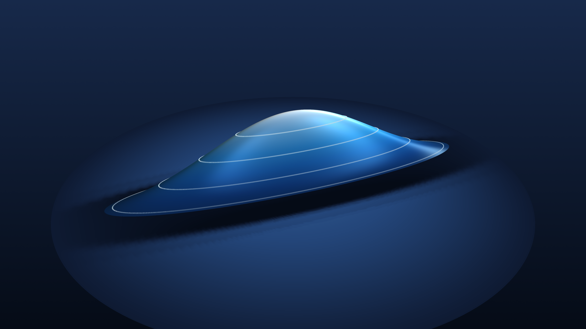
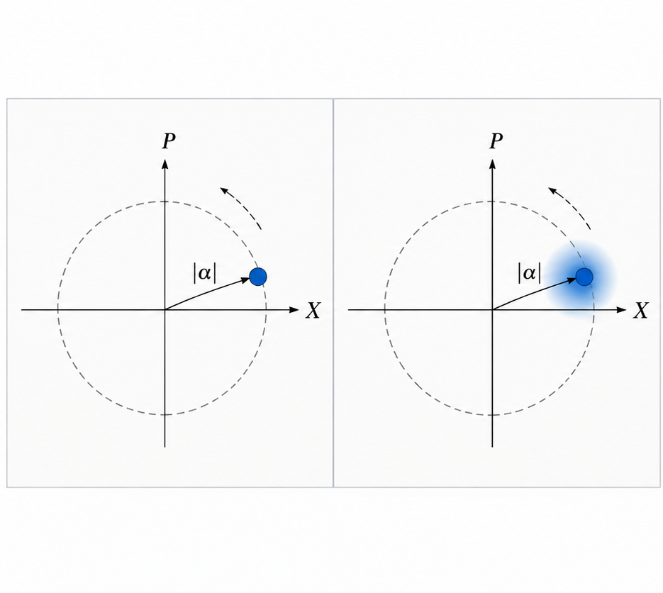
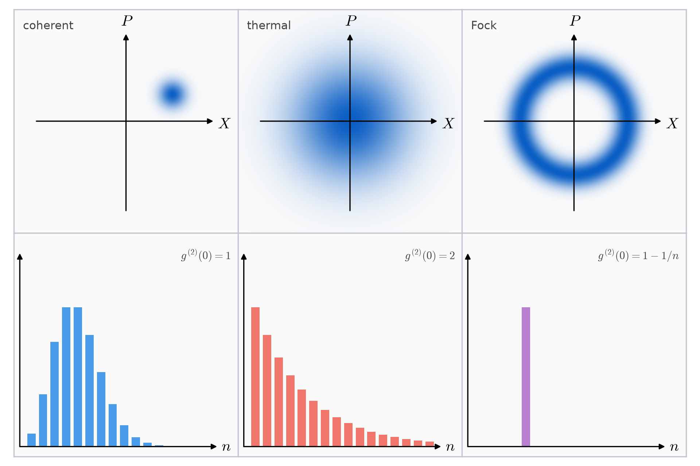

# States of Light
## What Lasers Teach Us About Light—and How That Lets Us Hear Gravitational Waves

> Caption: **Artists impression of squeezed vacuum. Image generated by author using PyVista."
In 1960 the first laser was built [1]. As a light source it was remarkably different from the sources traditionally used in optics. These, from lamps to stars, are chaotic: many atoms emit independently, and the beam is a jumble of their contributions. A laser, on the other hand, produces an exceptionally stable and coherent beam.

In the previous post we saw how Hanbury Brown and Twiss revealed correlations in light that ordinary interference experiments could not detect [2]. They called this method “intensity interferometry.” The quantity they measured is the “second-order correlation,” g⁽²⁾(0). The lowest value possible with classical light is 1, and chaotic light always exceeds this value.

The second-order correlation can be described by fluctuating intensities, caused by physical mechanisms in the source (for instance, thermal fluctuations). An alternative description of these same mechanisms is to say that the photons emitted by the source tend to be “bunched” together: if you detect one photon, it is more likely than average that you detect a second one immediately after.

So what should we expect from a laser for this correlation? It could behave like the chaotic light of stars, where photons tend to bunch together. It could generate light where photons arrive more regularly than chance would give. Or it could sit exactly on the boundary between the two, where photons arrive independently.

## A Laser Raises a New Question About Light

Before turning to the laser, imagine an “ideal” source that emits photons independently of one another. We split its light equally between two detectors and compare their photon clicks.

From a corpuscular perspective, detecting a photon at one detector tells us nothing about the probability of detecting a photon at the other. The detection events are independent, so their joint probability factorizes into the product of the individual probabilities.

If the probability of a click in a short time interval Δt is approximately IᵢΔt, where Iᵢ is the mean detection rate at detector i, then the probability of a coincidence is

$$
P_{12}\approx (I_1\Delta t)(I_2\Delta t).
$$

For a 50/50 splitter, I₁ = I₂ = I, giving

$$
P_{12}\approx (I\Delta t)^2.
$$

In other words, the coincidence rate contains no excess correlation beyond what we expect from independent detection events. For the detection rate this means

$$
\langle I_1I_2 \rangle = \langle I_1 \rangle\langle I_2 \rangle = \langle I \rangle^2.
$$

Now we evaluate the same source from a classical-wave perspective. The light from the source will have perfectly constant intensity. As before, the 50/50 beam splitter divides that intensity equally between the two detectors. Since neither intensity fluctuates, their product is simply the product of their averages:

$$
\langle I_1I_2\rangle=\langle I\rangle^2.
$$

Both views lead to a factorization of the intensity, and they are the same statement in two languages. Classically it follows from a constant intensity. In the corpuscular view it follows from independent photon arrivals, which also require a constant detection rate: a fluctuating rate would make one click raise the odds of the next.

The second-order correlation g⁽²⁾(0) is the normalized intensity cross-correlation ⟨I₁I₂⟩/(⟨I₁⟩⟨I₂⟩). If the cross term factorizes, g⁽²⁾(0) is equal to one, and we have just seen that this is the case for our ideal source.

Roy Glauber, who would spend his career at Harvard, had studied a problem closely related to our ideal light source in 1951 [3]. He considered a source of radiation whose motion was unaffected by the light it emitted. Imagine an oscillating electric charge that continues its motion regardless of the photons radiated away. Treating the electromagnetic field quantum mechanically, Glauber found that such a source, starting from an initially empty field, produces radiation with Poissonian photon-number statistics—the same statistics we would expect from independently emitted photons.

When the helium-neon laser appeared in 1960 [4], Glauber had to ask what Hanbury Brown and Twiss would find in its beam. A more monochromatic source stays coherent for longer, so one might guess that the photon correlations would extend over much longer times. He puzzled over this for some time [5]. The current that radiates light in a laser tube is a polarization current of bound charges. If it is strong enough, it can be treated like the prescribed current of 1951, one that suffers negligible recoil when individual photons are emitted. It seemed to him that a laser beam would then show no Hanbury Brown–Twiss correlations at all. Could its photon detections really behave as though they were completely independent?

If so, the factorization we found for two detectors should not stop at second order. The joint probability of detecting three photons should factorize into three individual probabilities, and similarly for four, five, or any number of detections. For n detectors, we would expect

$$
\langle I_1I_2\cdots I_n\rangle
=
\langle I_1\rangle\langle I_2\rangle\cdots\langle I_n\rangle.
$$

Or, in terms of normalized correlations,

$$
g^{(n)}=1
$$

for every order n.

But what kind of quantum state of light could satisfy this condition?

In 1963, Glauber answered this question by developing a theory of optical coherence [6]. He introduced correlation functions of the electromagnetic field itself. For a fully coherent field, these correlations factorize at every order. Quantum mechanics already contained a natural candidate for such a field: a state that is an eigenstate of the positive-frequency electric-field operator.

$$
E^{(+)}(x)|\psi\rangle=\mathcal E(x)|\psi\rangle.
$$

Here, E⁽⁺⁾(x) is the part of the electric-field operator associated with photon annihilation, while ℰ(x) is an ordinary complex field amplitude. For a single electromagnetic mode, the condition becomes

$$
a|\alpha\rangle=\alpha|\alpha\rangle,
$$

where a is the annihilation operator we introduced in our earlier discussion of quantizing light.

These states are called coherent states, or Glauber coherent states [7].

The annihilation operator removes one photon from the field, yet a coherent state remains the same state, apart from a multiplicative factor. After normalization, removing a photon does not change the state at all. Consequently, detecting one photon does not change the probabilities of subsequent detections, and the correlation functions factorize automatically.

For this to work, the state must contain an indefinite number of photons: only then can it survive the removal of one. This is the Poissonian spread of photon numbers that Glauber had found for the classical current in 1951.

An ideal laser operating well above its lasing threshold approaches this behavior closely. Coherent states therefore provide a natural quantum description of laser light.

So, what does a coherent state actually look like, and what is left of the quantum world in it?

## Even the Most Classical Light Has Quantum Uncertainty

A single mode of light oscillates at one frequency, and we can describe its state with one complex number, the amplitude *A* of Post 2. Plot *A* in a plane, with its real and imaginary parts on the two axes, and the state of the mode is a point in that plane. As the field oscillates, the point circles the origin once per optical cycle. Its horizontal position is the electric field at that moment, and its vertical position is the field a quarter cycle later. Together they fix everything the classical mode can do. A plane like this, which holds all the variables needed to describe the state, is called a phase space. It is the same plane in which a mechanical oscillator moves with its position and momentum. For the light mode, the two axes are called the field quadratures.

The distance of the point from the origin is the field amplitude, whose square is proportional to the intensity. Its angle is the optical phase. A classical wave can be at any point, with a definite amplitude and phase, and the point traces a circle at constant radius.

In Post 2 we found that quantization changes one thing about this picture: the two quadratures are the counterpart of position and momentum, so they do not commute. A mode cannot have both sharp at the same time, and the point cannot stay a point.

Glauber’s coherent state follows the same classical motion, but the point becomes a circular uncertainty cloud. The center of the cloud traces the same trajectory as the classical point, with the same mean amplitude and phase. The cloud is the unavoidable quantum uncertainty in the two quadratures: if we measured one of them many times on identically prepared light, the results would scatter over the width of the cloud. For a sufficiently bright field, the width along the radius is the amplitude uncertainty and the width along the circle is the phase uncertainty. For a coherent state the uncertainty is the same in both directions.

Ideal laser light is therefore extraordinarily close to a classical wave. Quantum mechanics does not replace the classical trajectory; it adds irreducible uncertainty around it.

> Caption: **Figure 1. Classical and Coherent Light in Phase Space.** Left: a classical wave is a point circling the origin; its distance from the origin is the amplitude and its angle is the phase. Right: a coherent state follows the same circle, but the point is replaced by a round cloud. The cloud is the minimum quantum uncertainty, the same in every direction, and its size does not grow with the amplitude.
> Source: Image by author.

## One Light Field, Many Quantum States

The coherent state is only one of the many quantum states an electromagnetic mode can occupy. We can compare it with two others: thermal light and photon-number states.

We have already encountered coherent states, which closely resemble classical electromagnetic waves. Their photon number follows a Poisson distribution: the number of photons fluctuates, but the detections show no excess correlations, so g⁽²⁾(0) = 1.

Thermal light behaves differently. Its photon number fluctuates considerably more than that of a coherent state with the same mean photon number, and the photons tend to arrive in bunches: for a single thermal mode, g⁽²⁾(0) = 2.

At the other extreme, quantum mechanics permits states with an exactly defined number of photons. These are called photon-number states, or Fock states. A Fock state contains precisely n photons, with no uncertainty in photon number. Its second-order correlation is

$$
g^{(2)}(0)=1-\frac{1}{n}.
$$

For a single-photon state, g⁽²⁾(0) = 0: detecting the photon rules out detecting a second one from the same preparation. This is below the classical limit of 1. It is photon antibunching, and no classical intensity fluctuation can produce it.

These states also look different in phase space. A coherent state is a round cloud whose center follows the classical trajectory. A thermal state is a broad, rotationally symmetric cloud centered on the origin. A Fock state is a ring: the radius, and therefore the photon number, is sharp, while the optical phase is completely undefined. The ring is a quantum probability distribution, not a classical field orbiting the origin.

The coherent state spreads its uncertainty evenly over amplitude and phase. The Fock state has an exactly defined photon number and pays for it with a completely undefined phase. This raises a question: can we choose that balance ourselves, reducing the fluctuations in one property of the field at the cost of increasing them in another?

> Caption: **Figure 2. Three Quantum States of Light. Three quantum states of a single electromagnetic mode. Top: phase-space distributions, drawn as the Husimi Q function. This is the uncertainty cloud blurred by one vacuum’s worth of uncertainty, so the cohereThree Quantum States of Light. Three states of a single mode with the same mean photon number. Top: phase-space pictures in the convention of Figure 1. Coherent light is a displaced disc with Poissonian photon numbers, g⁽²⁾(0) = 1. Thermal light is a broad cloud centred on the origin with geometric photon numbers, g⁽²⁾(0) = 2. A Fock state is a ring, schematic, with all its probability at exactly n photons, g⁽²⁾(0) = 1 − 1/n. Bottom: the corresponding photon-number probabilities.**
> Source: Image by author.

## What If We Could Squeeze Quantum Uncertainty?

We have seen that a coherent state is represented by a circular uncertainty cloud following the classical trajectory in phase space. But does quantum mechanics require this cloud to be circular? Could we change its shape, making it narrower in one direction and wider in another?

The two axes of phase space are the real and imaginary parts of the mode amplitude a. We call them X and P, so that a = X + iP. They are the cosine and sine components of the oscillating electric field, and, as for position and momentum, their uncertainties obey

$$
\Delta X\,\Delta P\geq\frac14.
$$

For a coherent state, the uncertainties are equal, ΔX = ΔP = ½, and their product is exactly the minimum allowed. But the uncertainty principle constrains the product, not the individual uncertainties. We can compress the cloud in one direction, provided we stretch it sufficiently in the other. For an ideal squeezed state, the uncertainty product remains unchanged:

$$
\Delta X=\frac12e^{-r},
\qquad
\Delta P=\frac12e^{r},
$$

where r describes the amount of squeezing. The circular cloud becomes an ellipse, but its uncertainty area remains the same. We have not eliminated quantum uncertainty; we have redistributed it.

For a bright field, the radial direction in phase space corresponds approximately to fluctuations in the field amplitude, while the tangential direction corresponds to fluctuations in its phase. Compressing the ellipse radially reduces amplitude uncertainty at the expense of phase uncertainty. This is called **amplitude squeezing**. Turning the ellipse by 90 degrees relative to the radial direction produces **phase squeezing**, reducing phase uncertainty while increasing amplitude uncertainty.

> Caption: **Figure 3. Amplitude and Phase Squeezing.** Both states follow the same classical trajectory, but their uncertainty clouds have become ellipses. Left: amplitude squeezing reduces radial fluctuations while increasing tangential fluctuations. Right: phase squeezing reduces tangential fluctuations while increasing radial fluctuations. In both cases, the uncertainty area remains unchanged.
> Source: Image by author.

So we can deliberately choose which component of the electromagnetic field has less quantum uncertainty. The same idea also applies to a field with no mean amplitude at all: the vacuum.

## Can We Squeeze the Vacuum?

So far we have squeezed the cloud of a field with a nonzero mean amplitude. What happens if we move the ellipse all the way to the origin of phase space, to the vacuum state?

The ordinary vacuum state |0⟩ is also a coherent state, with α = 0. Its cloud is a circle centered on the origin. The vacuum contains no photons, yet it still fluctuates in both quadratures:

$$
\langle X\rangle=\langle P\rangle=0,
\qquad
(\Delta X)^2=(\Delta P)^2=\frac14.
$$

These are the vacuum fluctuations, or zero-point fluctuations. There is no classical field circling the origin, but the uncertainty cloud is still there.

Now apply the same squeezing to the vacuum. The circle becomes an ellipse, and its center stays at the origin. One quadrature has less uncertainty than the ordinary vacuum, and the conjugate quadrature has more. As the field oscillates, the ellipse turns around its fixed center. This is **squeezed vacuum**.

> Caption: **Figure 4. Vacuum and Squeezed Vacuum.** The ordinary vacuum is a circle centered on the origin (dashed). Squeezing turns it into an ellipse of the same area, narrower than the vacuum in one direction and wider in the other. The center stays at the origin, and the ellipse turns with the oscillating field. Right: the photon-number distribution of the squeezed vacuum contains only even numbers.
> Source: Image by author.

### But Is Squeezed Vacuum Still Empty?

The picture is a cloud around nothing. What does it mean? The vacuum has no photons, so how can squeezing change it? It can, because squeezed vacuum is not the vacuum. To lowest order in the squeezing r, it is

$$
|0,\zeta\rangle \approx |0\rangle-\frac{r}{\sqrt2}\,|2\rangle+\cdots.
$$

The state is mostly vacuum, but it also contains a small amount of the two-photon state, and then four, six, and so on, always an even number. The mean photon number is

$$
\langle n\rangle=\sinh^2 r.
$$

Squeezing the vacuum therefore adds energy, and a photon counter placed in front of it will occasionally click. This is the crucial step. The ordinary vacuum never makes a counter click, but squeezed vacuum does. A click means that at least one photon was present. There is no one-photon term, so it means that two were present, or four, or six: a single click is already a pair. If we split the light over two detectors, as Hanbury Brown and Twiss did, the two photons of a pair leave through different outputs half of the time, and the detectors click together. That is bunching. The photon-number variance is Var(n) = 2⟨n⟩(⟨n⟩ + 1), and the second-order correlation is

$$
g^{(2)}(0)=3+\frac{1}{\langle n\rangle}.
$$

This is always larger than 3, which is more bunching than thermal light (g⁽²⁾(0) = 2). Suppose the noise in the narrow quadrature is half the vacuum value. Then ⟨n⟩ = 0.125 and g⁽²⁾(0) = 11.

The counter also tells us something about the ellipse. The mean photon number is related to the spread of the cloud by ⟨n⟩ = (ΔX)² + (ΔP)² − ½. The wide side of the ellipse grows more than the narrow side shrinks, so the counter responds to the enlarged side. It cannot see that the other direction has become narrower than the vacuum.

That narrow direction is the part we want. Can we see it?

### Seeing the Narrow Side of the Ellipse

A photon counter cannot see the narrow side. It counts photons, and the narrow side is not a photon number. It is a property of the field itself: how much the field fluctuates at one particular moment of its cycle. No detector can follow an optical field through its cycle, because the field oscillates at hundreds of terahertz.

Instead we let the field interfere with a bright reference beam of the same frequency. The reference is a coherent state, the laser light of the first section, and it acts as a clock. Put the reference in one input of a beam splitter and the squeezed vacuum in the other. As we saw for beam splitters, the second input is never empty: it carries the vacuum, or here the squeezed vacuum. The detector at the output sees the intensity of the reference plus a cross term between the reference and the weak field. That cross term is the quadrature of the weak field that is in phase with the reference, multiplied by the large amplitude of the reference. Its mean is zero, because the squeezed vacuum has no mean field. But it fluctuates, and those fluctuations are the noise of that quadrature, now amplified by the bright beam far above the detector’s own noise. The phase of the reference chooses which quadrature we look at. This is again a correlation, now between the weak field and a bright reference instead of between two detectors.

With ordinary vacuum in the second input, the noise is the same for every reference phase. This is the shot noise: vacuum fluctuations beating against the bright beam. It is the baseline. With squeezed vacuum the noise depends on the reference phase. It falls below the shot noise when the reference is aligned with the narrow axis of the ellipse, and rises above it a quarter cycle later, when the reference is aligned with the wide axis. In units of the shot noise, the noise at an angle θ from the narrow axis is

$$
e^{-2r}\cos^2\theta+e^{2r}\sin^2\theta.
$$

For e^(−2r) = ½, the noise power at the best phase is half the shot noise, which is 3 dB below it.

> Caption: **Figure 5. Seeing the Narrow Side.** Noise measured against a bright reference beam as the reference phase is varied (shot noise = 1). With ordinary vacuum the noise is flat. With squeezed vacuum it dips below the shot noise at one phase and rises above it a quarter cycle later. The insets mark the quadrature being measured on the ellipse at the lowest and the highest noise.
> Source: Image by author.

So the narrow side is real, and a bright reference beam can see it. A bright laser beam and a second input open to vacuum is also exactly the layout of a gravitational-wave detector.

## Squeezed Vacuum Is Not Just Theory

A laser interferometer for gravitational waves has the layout we just used. A bright laser beam enters one port, and the other port is open to the vacuum. A passing gravitational wave changes the relative lengths of the two arms by a tiny amount, and the signal appears as a small change in the quadrature that beats against the bright beam. The vacuum entering the open port adds noise to that same quadrature. At high frequencies this shot noise limits the measurement.

Carlton Caves pointed this out in 1981 and proposed replacing the vacuum at the open port by squeezed vacuum [8]. Daniel Walls described the idea in his 1983 review [9]. If the narrow axis of the ellipse is aligned with the measured quadrature, the noise goes down while the signal stays the same. The signal is not amplified; the noise that hides it is reduced. The price is more noise in the other quadrature, which shows up as radiation-pressure noise on the mirrors, mostly at low frequencies.

At the time, squeezed light had not been observed. Slusher and colleagues produced it in 1985 with four-wave mixing in an optical cavity [10], and Wu and colleagues produced squeezed vacuum in 1986 with parametric down-conversion, with quadrature noise more than 50% below the vacuum level [11]. GEO 600 was the first gravitational-wave detector to use squeezed light, in 2010 [12]. Advanced LIGO followed in its third observing run in 2019, with up to 3 dB less noise above 50 Hz and an expected 40–50% higher detection rate [13]. The first detection in 2015 did not use it [14]. In 2023 LIGO added a 300 m filter cavity that rotates the ellipse with frequency, so the same squeezed vacuum reduces both shot noise and radiation-pressure noise. It lowered the noise by 4.0 dB at Hanford and 5.8 dB at Livingston near 1 kHz [15].

This article started with starlight. Hanbury Brown and Twiss used correlations in light to measure the size of a star, and that work led to the quantum theory of optical coherence. The correlation of a bright laser with the quantum vacuum now helps us measure ripples in spacetime. Experiments motivated by astronomy helped establish modern quantum optics, and modern quantum optics now helps us observe the universe.

## References

1. T. H. Maiman, “Stimulated Optical Radiation in Ruby,” *Nature* **187**, 493–494 (1960). doi:10.1038/187493a0
2. R. Hanbury Brown and R. Q. Twiss, “Correlation between Photons in Two Coherent Beams of Light,” *Nature* **177**, 27–29 (1956). doi:10.1038/177027a0
3. R. J. Glauber, “Some Notes on Multiple-Boson Processes,” *Phys. Rev.* **84**, 395 (1951). doi:10.1103/PhysRev.84.395
4. A. Javan, W. R. Bennett Jr., and D. R. Herriott, “Population Inversion and Continuous Optical Maser Oscillation in a Gas Discharge Containing a He-Ne Mixture,” *Phys. Rev. Lett.* **6**, 106–110 (1961). doi:10.1103/PhysRevLett.6.106
5. R. J. Glauber, “Nobel Lecture: One Hundred Years of Light Quanta,” *Rev. Mod. Phys.* **78**, 1267 (2006). Lecture delivered 8 December 2005. doi:10.1103/RevModPhys.78.1267
6. R. J. Glauber, “The Quantum Theory of Optical Coherence,” *Phys. Rev.* **130**, 2529 (1963). doi:10.1103/PhysRev.130.2529
7. R. J. Glauber, “Coherent and Incoherent States of the Radiation Field,” *Phys. Rev.* **131**, 2766 (1963). doi:10.1103/PhysRev.131.2766
8. C. M. Caves, “Quantum-Mechanical Noise in an Interferometer,” *Phys. Rev. D* **23**, 1693 (1981). doi:10.1103/PhysRevD.23.1693
9. D. F. Walls, “Squeezed States of Light,” *Nature* **306**, 141–146 (1983). doi:10.1038/306141a0
10. R. E. Slusher, L. W. Hollberg, B. Yurke, J. C. Mertz, and J. F. Valley, “Observation of Squeezed States Generated by Four-Wave Mixing in an Optical Cavity,” *Phys. Rev. Lett.* **55**, 2409 (1985). doi:10.1103/PhysRevLett.55.2409
11. L.-A. Wu, H. J. Kimble, J. L. Hall, and H. Wu, “Generation of Squeezed States by Parametric Down Conversion,” *Phys. Rev. Lett.* **57**, 2520 (1986). doi:10.1103/PhysRevLett.57.2520
12. J. Abadie et al. (LIGO Scientific Collaboration), “A Gravitational Wave Observatory Operating beyond the Quantum Shot-Noise Limit,” *Nat. Phys.* **7**, 962–965 (2011). doi:10.1038/nphys2083
13. M. Tse et al., “Quantum-Enhanced Advanced LIGO Detectors in the Era of Gravitational-Wave Astronomy,” *Phys. Rev. Lett.* **123**, 231107 (2019). doi:10.1103/PhysRevLett.123.231107
14. B. P. Abbott et al. (LIGO Scientific Collaboration and Virgo Collaboration), “Observation of Gravitational Waves from a Binary Black Hole Merger,” *Phys. Rev. Lett.* **116**, 061102 (2016). doi:10.1103/PhysRevLett.116.061102
15. D. Ganapathy et al. (LIGO Scientific Collaboration), “Broadband Quantum Enhancement of the LIGO Detectors with Frequency-Dependent Squeezing,” *Phys. Rev. X* **13**, 041021 (2023). doi:10.1103/PhysRevX.13.041021
