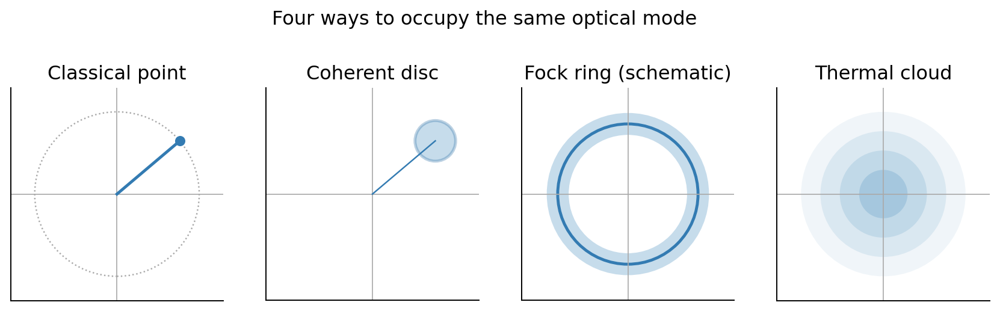
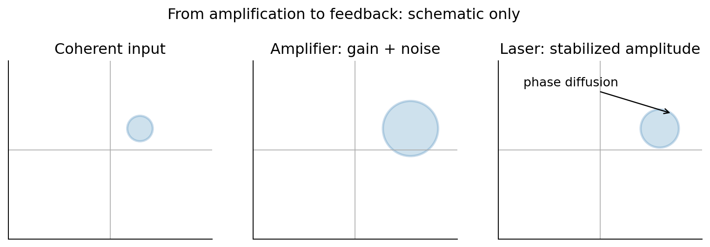
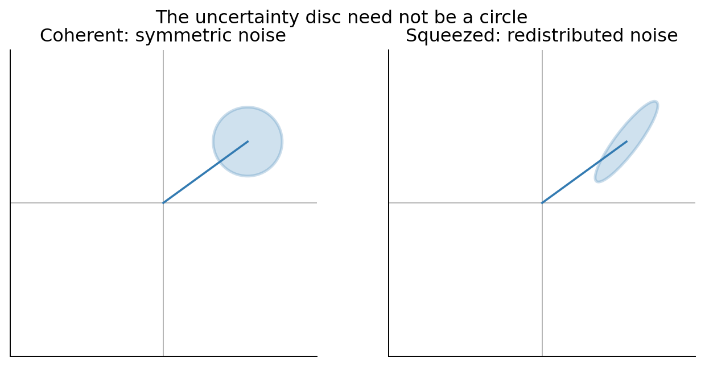

# Post 4 — Working Outline

**Status:** Story and physics development; not article prose. **Title/subtitle:** Open.

**Working theme:** The most quantum of optical devices—the laser—produces light that is strikingly classical in many measurements. Quantum uncertainty cannot be eliminated, but its distribution can be reshaped to improve measurements.

## Pixar Arc

- **Once upon a time:** A classical mode is a point rotating in phase space. A quantum mode has irreducible quadrature uncertainty. Fock, coherent, and thermal states occupy phase space differently.
- **Every day:** The coherent state is a special quantum counterpart of a classical wave: a minimum-uncertainty disc whose center follows the classical oscillator. Derive it as an annihilation-operator eigenstate and expand it in the Fock basis.
- **One day:** Ask whether an amplifier can move that disc farther from the origin without enlarging its uncertainty.
- **Because of that:** A phase-insensitive amplifier must add quantum noise to preserve commutation relations. Add cavity feedback, pumping, and gain saturation: the ingredients of a laser. The laser builds a stable mean intensity but retains phase diffusion and finite temporal coherence.
- **Until finally:** Return to the disc. Uncertainty need not be circular: squeezing makes an ellipse, reducing fluctuations in a chosen quadrature and enabling enhanced precision in suitable measurements.
- **Broader consequence:** A coherent state is among the most classical quantum states, but a more nonclassical state can be the better metrological resource.

## Proposed Sections (Provisional)

### 1. Four Pictures of Light

- Revisit Post 2's classical rotating phase-space point and Fock energy rings.
- Introduce quadratures `X = (a+a†)/2`, `P = (a−a†)/(2i)` and `ΔX ΔP ≥ 1/4`.
- Four panels: classical point; coherent uncertainty disc; Fock ring; thermal cloud.
- **Physics precision:** The ring/cloud are conceptual phase-space pictures, **not** exact Wigner plots; a Fock-state Wigner function has oscillatory structure and may be negative.
- **Figure 1** below.
- **Open:** Should the fourth panel initially show thermal light or squeezed light? Current preference: thermal, saving squeezing for the final twist.

### 2. The Coherent State: A Quantum Version of a Classical Wave

- Seek a minimum-uncertainty state with equal quadrature widths and a rotating mean amplitude.
- Derive `a|α⟩ = α|α⟩`, then `|α⟩ = exp(−|α|²/2) Σ αⁿ|n⟩/sqrt(n!)`.
- Poisson photon-number statistics, but not *equivalent* to coherence.
- **Open:** Show derivation by coefficient recursion in Fock basis, or displacement operator? Preference: coefficient recursion first, displacement operator optional.

### 3. Why Can't We Amplify the Disc Without Noise?

- A naive map `a_out = sqrt(G) a_in` fails: `[a_out,a_out†]=G`, not 1.
- A phase-insensitive quantum-limited amplifier requires an auxiliary mode, e.g. `a_out = sqrt(G) a_in + sqrt(G−1) b_in†`.
- Explain why added noise accompanies gain; contrast with passive unitary mixing in Post 3.
- This is **not** a model of a complete laser or a claim that every form of phase-sensitive amplification has the same noise penalty.
- **Figure 2**, left and middle.

### 4. Add Feedback: We Have a Laser

- Gain medium, pumped inversion, resonant cavity, outcoupling, saturation.
- Gain compensates loss and saturation stabilizes intensity; spontaneous emission seeds oscillation and contributes to phase diffusion.
- A well-above-threshold laser has approximately coherent-state-like behavior on suitable time scales, often nearly Poissonian counts and long first-order coherence.
- **Crucial nuance:** A free-running laser has no fixed absolute phase. A phase-averaged mixture is compatible with long-lived *relative/temporal* coherence. Do not say that gain automatically produces a pure `|α⟩`.
- **Figure 2**, right; final version should add actual cavity feedback loop and temporal phase wandering.
- **Open:** How much microscopic laser dynamics? Current decision: no extended Einstein A/B coefficient derivation; keep mode/amplifier route.

### 5. Return to the Disc: Squeezing and Metrology

- The uncertainty principle constrains a product, not equal variances.
- For minimum-uncertainty squeezed vacuum: `ΔX = e^(−r)/2`, `ΔP = e^r/2` (up to quadrature angle).
- An ellipse can reduce measurement noise in the quadrature sensitive to a small signal; mention interferometry and gravitational-wave detection as an application.
- Clarify that squeezing is angle-dependent and vulnerable to loss; it is not a universal sensitivity improvement.
- **Figure 3** below.

### Optional Counterexample — Poisson Counts Are Not Enough

- From an N-photon Fock state, trace over the other port of a beam splitter with transmission T: `P(k)=C(N,k) T^k(1−T)^(N−k)`.
- Limit `N→∞`, `T→0`, `NT=μ`: Poisson photon counts, **but a number-diagonal mixed state, not a coherent state**.
- A sequence of ordinary weak-loss splitters with fixed N and finite total transmission is still binomial; the Poisson limit requires the stated scaling.
- **Open:** Include as a short sidebar, save for another article, or omit to keep the laser arc moving? Not currently part of the main narrative.

## Draft Figures and Intended Captions

### Figure 1 — Four Phase-Space Pictures

**Intended caption:** A classical oscillator has a definite complex amplitude; a coherent state has a localized minimum-uncertainty distribution whose center rotates; a Fock state has fixed energy and no preferred phase; a thermal state fluctuates in both amplitude and phase. **Final figure:** match Post 2's phase-space axes and visual language; consider exact Husimi-Q distributions if mathematical accuracy is important, rather than a literal Fock ring.

### Figure 2 — Amplification, Noise, and Laser Feedback

**Intended caption:** Amplifying a coherent amplitude cannot simply displace the same uncertainty disc outward under phase-insensitive gain: quantum noise must be added. In a laser, feedback and gain saturation stabilize the intensity while quantum noise causes phase diffusion. **Final figure:** replace the last panel with a cavity-feedback schematic and a phase-space trajectory that slowly wanders around an approximately constant radius. Do not imply that feedback erases quantum noise.

### Figure 3 — A Circle Is Not Mandatory

**Intended caption:** Coherent light has equal noise in two orthogonal quadratures. Squeezed light trades increased fluctuations in one quadrature for reduced fluctuations in the other. Properly aligned with the measurement, this improves sensitivity to small changes such as an interferometric phase shift. **Final figure:** align the narrow ellipse axis with the actual signal displacement, and show a small phase shift to make the metrological advantage immediately visible.

## Open Editorial / Physics Decisions

- Title/subtitle and exact section count.
- Whether the fourth opening panel is thermal or squeezed; current preference is thermal.
- Whether to use exact Wigner/Husimi phase-space plots or conceptual sketches.
- Whether to include the attenuated-Fock-state Poisson counterexample.
- How much laser phase diffusion / linewidth to derive quantitatively.
- Whether to mention thermal statistics explicitly beyond the opening comparison.
- Metrology endpoint: conceptual squeezing example versus a compact signal-to-noise calculation.

## Link Back to Post 3

Post 3 shows that correlations expose nonclassical light. Post 4 asks what the state itself looks like, why a laser approximates a coherent state, and how deliberately changing its quantum fluctuations can make light a better measurement tool.
